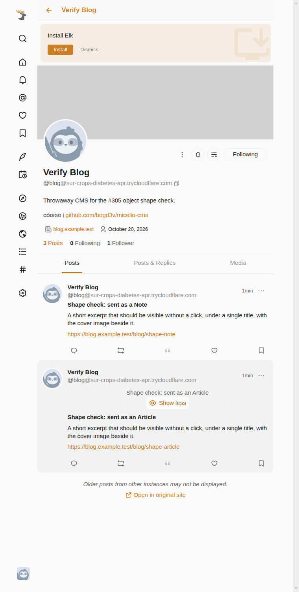
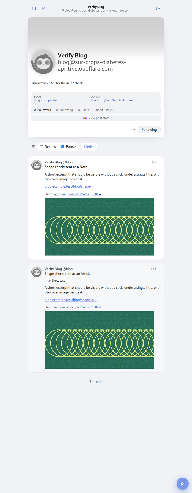
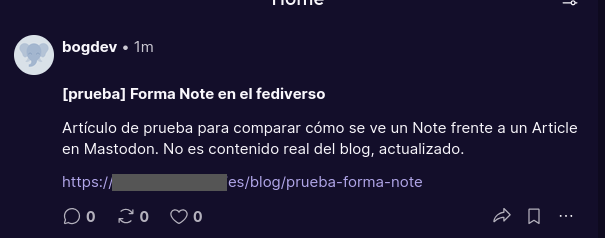
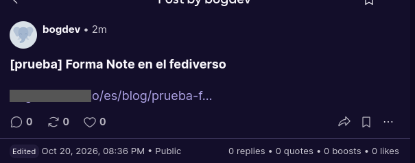
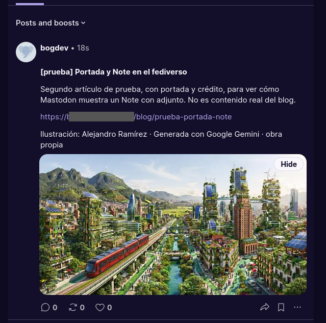

# Federation: how the plugin works

**Kind:** explanation. For the contributor who changes the plugin: the goal and decisions, the architecture, the federation flows, the moderation and security rules, the risks and the findings behind each non-obvious decision. The operator's side is [operate/configure.md](../operate/configure.md); the public routes are in [api.md](../api.md); the log lines and the keys are in [security/logging.md](../security/logging.md) and [security/keys.md](../security/keys.md).

This document is the source of truth for connecting a Micelio site to the fediverse, so users on Mastodon (and any other ActivityPub network) can follow the blog, receive published articles in their timeline, and reply, like, and boost, with replies landing as moderated comments in the `strapi-plugin-comments` collection of the host.

The plugin is `@micelio/strapi-plugin-fediverse` (`plugin::fediverse`). It ran inside `bogd3v/micelio-cms` as a local plugin until it moved into this package (the first step of the cut-over of ADR-0017 in `bogd3v/micelio`). The issues of `bogd3v/micelio-cms` that this document cites as `bogd3v/micelio-cms#n` are the history of each decision. What the host provides, and the contracts that never change (the actor id, the `/fediverse/notes/<documentId>` and `/fediverse/articles/<documentId>` ids, the followers' data, the comment anchors, `FEDIVERSE_ENABLED` and `FEDIVERSE_ACTOR_IDENTIFIER`), are in [What the host provides](../operate/configure.md#what-the-host-provides) and [Contracts that never change](#contracts-that-never-change).

## Table of Contents

- [Goal & Decisions](#goal--decisions)
- [Architecture](#architecture)
- [Components](#components)
- [Federation Flows](#federation-flows)
- [Discoverability on Other Networks](#discoverability-on-other-networks)
- [Moderation & Security](#moderation--security)
- [Sites](#sites)
- [Contracts that never change](#contracts-that-never-change)
- [Risks & Mitigations](#risks--mitigations)
- [Findings behind the design](#findings-behind-the-design)
- [Implementation notes](#implementation-notes)
- [Delivery queue](#delivery-queue)
- [Article panel](#article-panel)
- [Plugin page](#plugin-page)
- [Moderator replies](#moderator-replies)
- [Actor profile in the site settings](#actor-profile-in-the-site-settings)
- [Removal of the fallbacks](#removal-of-the-fallbacks)
- [Cross-server verification](#cross-server-verification)
- [Object shape: Article or Note](#object-shape-article-or-note)
- [Changing the handle without losing followers](#changing-the-handle-without-losing-followers)
- [Author attribution](#author-attribution)
- [Origin of the ids](#origin-of-the-ids)
- [Remote text in logs and storage](#remote-text-in-logs-and-storage)
- [Fedify's LogTape records](#fedifys-logtape-records)
- [Inbox digest algorithms](#inbox-digest-algorithms)
- [Actor key at rest](#actor-key-at-rest)
- [Future Work](#future-work)
- [References](#references)

---

## Goal & Decisions

| Decision         | Choice                                                                                                            |
| ---------------- | ----------------------------------------------------------------------------------------------------------------- |
| Architecture     | **Fedify embedded in Strapi** as a plugin of the host: no sidecar service, single deploy unit                     |
| Protocol library | [`@fedify/fedify`](https://fedify.dev) + `@fedify/koa` Koa middleware (same stack Ghost uses for its ActivityPub) |
| Actor domain     | `cms.example.com` → handle `@blog@cms.example.com` (served directly by Strapi; no reverse-proxy changes)          |
| Actor identity   | Single blog actor (not per-author)                                                                                |
| Replies storage  | Existing `strapi-plugin-comments` collection, entering as `PENDING` for the existing approval workflow            |
| Scope            | Follow + article federation + replies-as-comments **plus likes & boosts**                                         |
| i18n             | Only the default locale federates                                                                                 |

Rejected alternatives (for context):

- **Sidecar microservice** (Ghost's exact `TryGhost/ActivityPub` architecture) — cleaner isolation but an extra service, proxy config, and database.
- **Bridgy Fed + webmentions** — zero protocol code but a third-party hosted bridge, frontend microformats2 changes, and less control.
- **Cross-posting to an existing Mastodon account** — syndication, not federation; replies would not flow back as site comments.

---

## Architecture

```
Mastodon / Pleroma / Misskey / Friendica / any ActivityPub server
   │  WebFinger, HTTP signatures, inbox delivery (ActivityPub S2S)
   ▼
cms.example.com  (Strapi 5 = Koa)
   ┌──────────────────────────────────────────────────────────┐
   │  plugin: @micelio/strapi-plugin-fediverse                │
   │                                                          │
   │  @fedify/koa middleware mounted via strapi.server.use()  │
   │    /.well-known/webfinger                                │
   │    /.well-known/nodeinfo  +  /nodeinfo/2.1               │
   │    /fediverse/user/blog          (actor)               │
   │    /fediverse/user/blog/inbox     (personal inbox)     │
   │    /fediverse/inbox                 (shared inbox)       │
   │    /fediverse/user/blog/followers                       │
   │    /fediverse/user/blog/outbox                          │
   │    /fediverse/articles/:documentId (Article objects)     │
   ├──────────────────────────────────────────────────────────┤
   │  Strapi core                                             │
   │    api::article.article        (publish events → fan-out)          │
   │    plugin::comments.comment   (replies → PENDING, hidden until approved)│
   │    plugin content types: follower, interaction, federated-article │
   │    GET /api/fediverse/articles/:documentId/stats (public)         │
   │    GET /api/fediverse/articles/stats | ranking (public)           │
   └──────────────────────────────────────────────────────────┘
                 │
                 ▼
   Article objects carry url → https://example.com/blog/{slug}
   (humans click through to the frontend; the fediverse dereferences
    the JSON-LD object on cms.example.com)
```

Fedify handles the protocol hard parts: HTTP signatures (including Mastodon's draft-cavage vs RFC 9421 "double-knock" quirks), WebFinger server, NodeInfo, JSON-LD Activity Vocabulary, and inbox signature verification **before** any listener code runs.

**Path collisions:** a Strapi host already serves `/api/*`, `/admin`, `/upload/*`, `/_health` and static `/public`. The plugin claims `/.well-known/*`, `/nodeinfo/*` and `/fediverse/*` for Fedify, `/api/fediverse/*` for its public routes ([api.md](../api.md)) and `/fediverse-panel/*` for the admin ([Article panel](#article-panel)); a host that serves anything else under those prefixes collides with it.

---

## Components

### Plugin parts

| Part                      | Responsibility                                                                                                                                                                                                                                                                                         |
| ------------------------- | ------------------------------------------------------------------------------------------------------------------------------------------------------------------------------------------------------------------------------------------------------------------------------------------------------ |
| `register()`              | Create the `Federation` instance and mount `@fedify/koa` middleware via `strapi.server.use()` (must be `register()`, not `bootstrap()`; see [Hosting in Strapi](#hosting-in-strapi))                                                                                                                   |
| `bootstrap()`             | Subscribe to `entry.publish` / `entry.unpublish` / `entry.delete` on `strapi.eventHub` (Strapi 5 does **not** emit publish lifecycles via `strapi.db.lifecycles`; see [Hosting in Strapi](#hosting-in-strapi)); `server/src/services/publisher.ts` turns them into `Create`/`Update`/`Delete(Article)` |
| Actor dispatcher          | Serves `/fediverse/user/blog` — username, name, bio, header and `discoverable` from the default site's `fediverse` component (then `global`'s name and description, and the default site's), avatar from `global`, `Blog`/`Código` profile fields, `url` pointing at the frontend                      |
| Key pairs dispatcher      | Reads the default site's keypairs from plugin store (`strapi.store({ type: 'plugin', name: 'fediverse' })`, key `keyPairs:<site documentId>`), the private key encrypted with `ENCRYPTION_KEY` (see [Actor key at rest](#actor-key-at-rest))                                                           |
| Article object dispatcher | Serves `/fediverse/articles/:documentId` as an `Article` (title, self-contained HTML body, frontend `url`, cover image) — published default-locale articles only                                                                                                                                       |
| Outbox dispatcher         | Serves `/fediverse/user/blog/outbox` — paginated, publicly-addressed `Create(Article)` activities, so a remote server can show/backfill recent posts before anyone there has followed the blog                                                                                                         |
| Followers dispatcher      | Backed by the `fediverse-follower` content type, the default site's rows                                                                                                                                                                                                                               |
| NodeInfo dispatcher       | Serves `/nodeinfo/2.1` with honest software/usage stats (published article count)                                                                                                                                                                                                                      |
| Inbox listeners           | `Follow`, `Undo(Follow)`, `Block`, `Create(Note)`, `Update(Note)`, `Delete(Note)`, `Like`, `Announce` + `Undo`                                                                                                                                                                                         |
| Services                  | `articles` + `publisher`, `replies`, `interactions`, `followers`/`keys`/`actor-profile`                                                                                                                                                                                                                |

The sources are in `server/src/`: `index.ts` (the plugin entry), `server/src/federation.ts` (the Fedify dispatchers and inbox listeners), `services/`, `controllers/`, `routes/`, `utils/`, `constants/`, `types/` and `content-types/`; the admin code is in `admin/src/`.

### Plugin content types

All three are made with `withSiteScope` of `@micelio/strapi-plugin-core/strapi-server`: each row has a required `site` relation (ADR-0017, section 4), and a service reads and writes only the rows of one site ([Sites](#sites)).

| Content type                          | Fields                                                                                                                                                                                                                                                                                                                                 |
| ------------------------------------- | -------------------------------------------------------------------------------------------------------------------------------------------------------------------------------------------------------------------------------------------------------------------------------------------------------------------------------------- |
| `plugin::fediverse.follower`          | `actorId` (string, AP actor URI), `handle` (`@user@host`), `name`, `inbox`, `avatar` (same rule as `authorAvatar`), `blocked` (boolean), `unreachableSince` (datetime: set when the inbox answered `404`/`410`, cleared by any activity from the actor)                                                                                |
| `plugin::fediverse.interaction`       | `type` (enum `like`/`boost`), `actorId`, `handle`, `articleDocumentId` (string, not a relation, see [Likes and boosts](#likes-and-boosts)), `interactionKey` (`type\|actor\|article`, used to dedupe)                                                                                                                                  |
| `plugin::fediverse.federated-article` | `articleDocumentId` (string, not a relation, one row per article), `status` (enum `created`/`updated`/`deleted`/`failed`), `createSentAt`, `lastActivityAt`, `lastActivityType` (enum `Create`/`Update`/`Delete`), `attempts` (integer, of the last activity), `lastError` (text, sanitized: no query string, no IP literal, no email) |

### Comment schema extension

The plugin stores a fediverse reply as a comment of `strapi-plugin-comments`, which does not have the fields it needs. **The host adds them**: this plugin does not extend another plugin's schema. The extension is a `strapi-server` extension of the comments plugin, not an extension `schema.json`, on purpose: Strapi merges schema files shallowly (`{ ...original, ...extension }`), so a `schema.json` declaring `attributes` would replace every attribute of the plugin and break it on the next upgrade. The minimal host of this repository does it in `test/app/src/extensions/comments/strapi-server.js`; what a host provides is listed in [operate/configure.md](../operate/configure.md#what-the-host-provides).

| Field                  | Purpose                                                                                                                           |
| ---------------------- | --------------------------------------------------------------------------------------------------------------------------------- |
| `fediverseUri`         | Remote Note object id (unique — checked by the Document Service, not a DB index) — dedupe of ingested replies + thread resolution |
| `fediverseActorHandle` | `@user@host`, or `null` when it could not be resolved for the remote author (display/source badge on frontend)                    |

The host adds two more attributes, non-public, for a moderator's reply: `fediverseNoteUri` and `fediverseNoteRetracted` (see [Moderator replies](#moderator-replies)).

### Custom public routes

Three `GET /api/fediverse/articles/…` routes serve counts and a ranking, and the outbox has a cursor. They are `auth: false`, aggregates only (never who interacted) and absent when the plugin is off. Their parameters, limits and answers are in [api.md](../api.md); the query behind them is in [Counts and ranking](#counts-and-ranking).

### Dependencies

- `@fedify/fedify` (pin exact 2.x version — the framework moves fast)
- `@fedify/koa` (Koa v2/v3 middleware)
- `@fedify/postgres` (pinned exactly, the same version as Fedify: `PostgresKvStore` and `PostgresMessageQueue`; MIT, maintained by the Fedify project) and `postgres` (its driver and peer dependency, pinned exactly; Unlicense, one maintainer)
- `@js-temporal/polyfill` (Fedify's timestamp type; explicit because Node has no global `Temporal`)
- `@logtape/logtape` (Fedify's logger, already installed through it; direct so the plugin's `configureSync` resolves the same package Fedify logs to)
- `structured-field-values` (pinned exactly to the copy Fedify uses, for the `Signature-Input` check; see [RFC 9421 signatures must cover `content-digest`](#rfc-9421-signatures-must-cover-content-digest))

### Environment variables

The variables, their defaults and what each does are in [operate/configure.md](../operate/configure.md#environment-variables). Two of them are contracts: `FEDIVERSE_ENABLED` and `FEDIVERSE_ACTOR_IDENTIFIER` ([Contracts that never change](#contracts-that-never-change)).

### KV store and delivery queue

Fedify needs a `kv` for caches, inbox idempotency and its circuit breaker, and a message queue for outgoing deliveries. Both follow the database Strapi runs on, with no variable to choose (`server/src/utils/federation-backend.ts`):

| Database   | `kv`                                   | Queue                                                                    |
| ---------- | -------------------------------------- | ------------------------------------------------------------------------ |
| PostgreSQL | `PostgresKvStore` (`@fedify/postgres`) | `PostgresMessageQueue`: a table, `LISTEN`/`NOTIFY`, a poll every 5 s     |
| SQLite     | `MemoryKvStore`                        | `InProcessMessageQueue`: memory, lost on restart (development and tests) |

Both Postgres backends share one small pool of their own (`FEDIFY_POOL_SIZE` in `server/src/constants/queue.ts`: 3 connections, plus the one the queue keeps open to listen), so federation never competes with Strapi's pool; the operator's view is in [operate/configure.md](../operate/configure.md#delivery-queue-and-database-connections). The tables, `fedify_kv_v2` and `fedify_message_v2`, are created on first use in the schema Strapi uses. All persistent federation state still lives in Strapi content types or the plugin store (followers, actor keys, interactions, comments, `federated-article` rows); the queue only holds what is waiting to be sent.

The queue worker starts in the plugin's `bootstrap()` (`manuallyStartQueue: true`, `startFederationQueue`), not at the first request, so what a previous run left in the table is delivered as soon as the CMS is up, and stops in `destroy()`. Only the `outbox` and `fanout` queues are set: the inbox is still handled while the request is open.

### Delivery, retries and what the row says

`ctx.sendActivity` signs the activity and enqueues it, so the `entry.publish` handler returns once it is queued and publishing in the admin does not wait for any remote server. Fedify delivers each inbox as its own message and retries a failure with its default `outboxRetryPolicy` (exponential backoff from 1 to 2 seconds, doubling, up to 10 retries: about 20 to 35 minutes in all; the 12-hour cap is never reached). The plugin adds nothing to that policy; `plugin::fediverse.outboxRetryPolicy` in the Strapi config replaces it for tests.

What the `federated-article` row records for the last activity:

| Field                      | Meaning                                                                                                                                                                                      |
| -------------------------- | -------------------------------------------------------------------------------------------------------------------------------------------------------------------------------------------- |
| `lastActivityAt`, `status` | When it was queued, and `created`/`updated`/`deleted`. Nothing says it was **delivered**: Fedify 2.4.4 has no callback for a delivery that worked, so every panel and log line says "queued" |
| `attempts`                 | Delivery attempts made or scheduled for the inbox that has been retried most. 1 when queued                                                                                                  |
| `lastError`                | The last failure, sanitized: for a refusing inbox only its host and HTTP status, never its answer                                                                                            |
| `status: failed`           | At least one inbox was given up on (a `404`/`410`, or the retry policy ran out). Others may have received it (bogd3v/micelio-cms#296). A later success does not clear it                     |

A delivery that fails and is retried raises `attempts` and sets `lastError` but keeps the status; it only turns `failed` when Fedify gives up. A delivery that eventually works leaves its `lastError` behind.

An inbox that answers `404` or `410` is gone for good. Fedify calls `setOutboxPermanentFailureHandler` once and does not retry, and the plugin flags every follower at that inbox with `follower.unreachableSince`. A flagged follower is skipped by the next fan-outs (the log says `N unreachable skipped`) but stays in the followers collection and its count. Any signed activity from that actor, whatever it is, clears the flag (`heardFrom` wraps every inbox listener), and the next fan-out includes it again. Other failures, an inbox that only answers `5xx` or is down for days, are retried and then abandoned with the row `failed`, but the follower is not flagged: only a definitive answer takes a follower out.

---

## Federation Flows

### 1. Follow

1. Remote user searches `@blog@cms.example.com` → WebFinger resolves → actor profile shown.
2. Inbox receives `Follow` → create `fediverse-follower` row → auto-send signed `Accept`. A blocked actor's `Follow` is ignored with no answer (neither `Accept` nor `Reject`, so it is not told it is blocked).
3. `Undo(Follow)` or incoming `Block` → remove follower, unless the actor is blocked: a blocked row is kept, so an actor cannot lift its own block. Admin sets `blocked: true` → excluded from fan-out, their activities ignored. Unblocking one row of an actor that has another blocked row keeps it blocked. Deleting a blocked row in the admin panel lifts the block (the next `Follow` creates a fresh row): to keep it, leave the row and its flag. Unblocking an actor whose row was kept makes it an active follower again, even if it undid its follow meanwhile; delete the row instead to drop it.

### 2. Publish / update / delete articles

1. Plugin `bootstrap()` subscribes via `strapi.eventHub.on(...)` to `entry.publish`, `entry.unpublish` and `entry.delete` (payload `{ model, uid, entry }`). Events fire **asynchronously, after the operation's transaction commits** — handlers must not assume the DB still holds the pre-operation state. In Strapi 5 an edit only reaches the published version when the editor publishes again, so `entry.publish` is also the signal for edits.
2. `entry.publish` → build `Article` object → signed `Create(Article)` addressed **publicly** (`to: https://www.w3.org/ns/activitystreams#Public`, `cc:` the followers collection) and delivered to every accepted follower's inbox. Public addressing — not just `cc` to followers — is what makes the post eligible for a remote instance's local/federated timeline and public directories; addressing it only to followers would silently cap reach at people who already follow the blog, which undermines the "consumed on other networks" goal (see [Discoverability on Other Networks](#discoverability-on-other-networks)).
3. The same `Create(Article)` activities are also served from a public **outbox dispatcher** (`/fediverse/user/blog/outbox`, paginated), so a remote server that discovers the actor — e.g. someone views the profile before deciding to follow — can backfill recent posts. Several Mastodon-derived UIs fetch the outbox on first contact with an unfollowed account.
4. Mastodon renders `Article` as a link card (title, excerpt, cover image from `media.example.com`, link to frontend).
5. Re-publishing an article that was already sent → `Update(Article)` (tracked in the `plugin::fediverse.federated-article` row, so no duplicate `Create`); unpublish or delete → `Delete(Article)` with a `Tombstone`, but only if no published default-locale version remains. The activities are queued and delivered in the background ([Delivery, retries and what the row says](#delivery-retries-and-what-the-row-says)); an error while queueing is logged and never breaks the editor's publish flow, and with no followers nothing is queued and the log says so.
6. Article AP id is stable: `/fediverse/articles/{documentId}`.
7. **i18n:** only the default locale federates.

### 3. Reply → comment

1. Inbox receives `Create(Note)` with `inReplyTo` pointing at:
   - our article AP id (`/fediverse/articles/{documentId}`) → top-level comment, or
   - the frontend article URL pattern (some clients use `url`), or
   - another note's URI matching a stored comment's `fediverseUri` (or a moderator's `fediverseNoteUri`) → `threadOf` = that comment (one hop, the fast path), or
   - a note we never received (a branch that grew on the remote side, or a note sent while the CMS was down) → the parents are fetched, see [Threads deeper than one hop](#threads-deeper-than-one-hop).

   Anything that doesn't resolve to one of our published articles is ignored: it is not our conversation.

2. Create `plugin::comments.comment` via `strapi.documents()`:

| Comment field          | Source                                                                                                                                               |
| ---------------------- | ---------------------------------------------------------------------------------------------------------------------------------------------------- |
| `content`              | Remote Note content, sanitized to plain text (strip HTML)                                                                                            |
| `authorName`           | Actor `name` or `preferredUsername@host`                                                                                                             |
| `authorAvatar`         | Actor `icon.url`, kept only as an absolute `http(s)` URL without credentials, at most 255 characters (`server/src/utils/remote-url.ts`), else `null` |
| `authorId`             | Remote actor URI (stable identity). `authorEmail` is never set: the plugin exposes it publicly                                                       |
| `threadOf`             | Resolved parent (see above), else `null`                                                                                                             |
| `approvalStatus`       | `PENDING` — set explicitly; the plugin's public API would show it, so a global middleware hides it until a moderator approves                        |
| `locale`               | The default (federated) locale; the frontend reads comments per locale (`?locale=`), and only that version federates                                 |
| `fediverseUri`         | Note object id (dedupe key)                                                                                                                          |
| `fediverseActorHandle` | `@user@host`, or `null` when it could not be resolved                                                                                                |

3. Dedupe: skip if a comment with the same `fediverseUri` exists.
4. `Update(Note)` → edit the content **and send the comment back to `PENDING`** (an approved comment must not be swappable for spam); `Delete(Note)` → set `removed`. Both are only honoured from the original author.
5. Admin approves/rejects in the existing comments moderation view — no new admin UI needed.

#### Threads deeper than one hop

Code: `server/src/services/reply-threads.ts` (the walk), `threadFetcher` in `server/src/federation.ts` (the fetches), limits in `server/src/constants/replies.ts`.

1. When a delivered reply's `inReplyTo` matches nothing stored, its parent is fetched with the blog's signed document loader (servers that require authorized fetch answer it), then the parent's parent, until one replies to an article, a stored comment or a moderator's note. Our own ids are never fetched back from ourselves, and only `http(s)` ids are fetched. The note is loaded directly and parsed with `Object.fromJsonLd`, not through `lookupObject`: when a fetch fails, `lookupObject` falls back to an unsigned WebFinger lookup of the URL and fetches whatever `self` link it returns, which could hand back a note of another host and adds requests the budget does not count.
2. **Bounded per delivery.** At most `MAX_THREAD_DEPTH` (5) notes are fetched, and the fetches and the authors' profiles share one budget of `THREAD_TIME_BUDGET_MS` (5 s) through an `AbortSignal`. Inbox listeners run while the sender waits for the answer, so a server that never answers holds the inbox for the budget, not for Fedify's 10 s per document. A chain that has not reached our conversation within the depth or the budget, that ends at a post answering nothing, or whose next note cannot be fetched, is dropped whole: nothing is stored.
3. **Each fetched note is checked as a delivered one would be.** It must be a `Note` addressed to the public (`to` or `cc`); a followers-only or direct note could otherwise reach a public site through the signed fetch. Its id and its author (`attributedTo`) must have the origin of the URL it was fetched from, and a redirect to another origin is refused: a server vouches only for its own notes and actors, as the signature does for a delivered note. The content goes through the same sanitization (`storeReply`).
4. **Stored from the top down.** The article being published is checked once, then every fetched note becomes a `PENDING` comment with its own `fediverseUri`, nested under the one above it, and the delivered reply last. A note that another delivery stored meanwhile is reused as the parent.
5. **A blocked actor stops the branch at its note.** The notes above it stay stored (they are a valid conversation on their own); the blocked note and everything under it, the delivered reply included, are not. A fetched note that is empty once sanitized (an image-only post, or one that only mentions the blog) stops the branch the same way: it cannot be stored, and its replies have nothing to nest under. The delivered reply's own author being blocked is still refused before anything is fetched.
6. A delivered reply that is empty once sanitized fetches nothing.

### 4. Likes & boosts

1. Inbox receives `Like(Article)` → upsert `fediverse-interaction` (type `like`).
2. `Announce(Article)` → upsert type `boost`.
3. `Undo(Like)` / `Undo(Announce)` → remove the row.
4. Stats endpoint aggregates counts for the frontend.

### 5. Reply → remote thread

1. A moderator answers a fediverse comment in the admin's comments view: the comments plugin creates a comment with `threadOf` (the remote comment), `authorId` (the admin user's id) and `isAdminComment: true`.
2. The plugin hooks the database lifecycle of `plugin::comments.comment` (`server/src/services/reply-publisher.ts`), so it sees that creation and every later change or removal. A reply federates only if: an admin user who has the permission to moderate comments wrote it; its parent is a **fediverse** comment of someone else (it has a `fediverseUri`) that is itself shown; and the article is published. A reader's or guest's comment, a reply to a local comment and a reply by an admin account without that permission send nothing.
3. It stores the reply's own note id in `fediverseNoteUri` (`<origin>/fediverse/notes/<documentId>`) and sends a signed `Create(Note)` from the blog actor: `inReplyTo` the remote note, `to` the remote author, `cc` the public collection and the followers, a `Mention` tag of the author, `content` the comment text as escaped HTML (a paragraph per blank line), `url` the article page with `#comment-<documentId>`. It goes to the remote author's inbox, found by fetching the author's actor with the blog's signed loader (not if the author is blocked here), and to every reachable follower, through the queue. The public `fediverseUri` and `fediverseActorHandle` stay `null`, so the frontend does not mark the site's own reply as remote.
4. Editing the text sends an `Update(Note)`. Removing, blocking (the reply, or a thread above it), rejecting it, sending it back to moderation, or deleting its row sends a `Delete(Note)` with a `Tombstone`; showing it again sends a `Create` again. Every activity has an id of its own.
5. `GET /fediverse/notes/<documentId>` serves the `Note` only while the reply is shown: `404` once it is removed, blocked, pending or rejected, and for any comment that is not a moderator's reply to a fediverse comment.
6. A reply to the admin's note from Mastodon arrives as a `Create(Note)` whose `inReplyTo` is the note id: reply ingestion finds the comment by `fediverseNoteUri` and nests it. A reply to a remote reply of that note that never reached us is resolved by fetching it ([Threads deeper than one hop](#threads-deeper-than-one-hop)).

---

## Discoverability on Other Networks

The technical mechanism is accepting `Follow`s and fanning out to followers, but the actual goal — blog content **consumed on other social networks**, not only by people who already follow the blog — needs a bit more than that:

- **Public addressing** (Federation Flows §2) is required for posts to land in a remote instance's local/federated timeline and directories, not just in individual followers' home feeds. This is a correctness requirement, not a nice-to-have: without it, federation "works" (followers see posts) but the blog is effectively invisible to everyone else on that instance.
- **Outbox dispatcher** (`/fediverse/user/blog/outbox`) lets remote servers and apps enumerate recent posts without requiring a follow first. It is a feature of its own, not an implementation detail of the actor dispatcher.
- **`discoverable` actor flag** (`toot:discoverable: true`, from Mastodon's `toot` vocabulary extension namespace): opts the actor into Mastodon's public directory and "suggested accounts." Set on the `Person` object.
- **Cross-server verification**: ActivityPub implementations diverge in how they parse `Article` and `Person` objects. Mastodon is the reference target, but Pleroma/Akkoma, Misskey, Friendica, and GoToSocial are all realistic destinations for this blog's followers, and Meta's Threads has historically shipped partial/limited outbound federation. A non-Mastodon server (GoToSocial) has been checked for the follow, profile, reply and article flows ([Cross-server verification](#cross-server-verification)); Pleroma/Akkoma, Misskey and Friendica have not.
- **Fediverse relays** (submitting the actor's public posts to a relay so instances with no existing followers of this domain still see them) are a plausible reach multiplier beyond direct follows, but out of scope for now (see [Future Work](#future-work)).

---

## Moderation & Security

- **Signature verification:** Fedify verifies HTTP signatures before listeners run — unsigned/forged activities never reach ingestion code. That only covers the _outer_ activity's actor, so listeners also check that an embedded activity (`Undo(Follow)`) or object (`Note.attributedTo`) belongs to the verified sender, and interaction withdrawals key on the verified sender.
- **Content sanitization:** remote Note content is HTML from untrusted servers — strip to plain text before storing.
- **Moderation:** all fediverse replies enter `PENDING` and are approved in the existing comments moderation view; remote actors can be `blocked` (their replies are ignored). The `approvalScores`/`moderation`/`nested` options in a host's `config/plugins.ts` are **not** options of `strapi-plugin-comments` 3.x (the only approval option is `approvalFlow: [uids]`) and have no effect; `PENDING` is set explicitly by the reply-ingest code (`server/src/services/replies.ts`). Edited replies go back to `PENDING` so an approved comment can't be swapped for spam.
- **Pending replies are hidden by a middleware the host provides.** The comments plugin's public endpoints return _every_ comment unless the caller filters by `approvalStatus`, and a frontend usually doesn't. The host mounts a global middleware (`src/middlewares/hide-unapproved-comments.ts` in `bogd3v/micelio-cms`, `test/app/src/middlewares/hide-unapproved-comments.js` in this repository) that prunes `PENDING`/`REJECTED` comments and their subtrees from `GET /api/comments/*`, and another (`fediverse-comment-fields.js`) that removes the non-public fediverse fields. They are the host's rather than the plugin's so they keep protecting readers even when the plugin is disabled; a host that installs the plugin without them publishes remote spam instantly ([operate/configure.md](../operate/configure.md#what-the-host-provides)).
- **Public API surface unchanged:** fediverse endpoints are handled by Fedify's middleware outside Strapi's auth/permissions; the public REST routes are the stats and ranking ones (`auth: false`, [api.md](../api.md)). The host needs no permission seed for them.
- **SSRF:** Fedify fetches remote objects (standard fediverse behavior); keep Fedify updated to benefit from its fetch hardening. Every destination the plugin contacts, and why there is no host allowlist, is in [security/outbound.md of `bogd3v/micelio-cms`](https://github.com/bogd3v/micelio-cms/blob/main/docs/security/outbound.md).

---

## Sites

Every row the plugin keeps belongs to one site, and the actor key has one entry per site. Where each is keyed:

| What                                  | Keyed by site as                                                                    | Read and written by                                                   |
| ------------------------------------- | ----------------------------------------------------------------------------------- | --------------------------------------------------------------------- |
| `plugin::fediverse.follower`          | the `site` relation                                                                 | `server/src/services/followers.ts`                                    |
| `plugin::fediverse.interaction`       | the `site` relation                                                                 | `server/src/services/interactions.ts`, `server/src/services/stats.ts` |
| `plugin::fediverse.federated-article` | the `site` relation                                                                 | `server/src/services/federated-articles.ts`                           |
| The actor key                         | the plugin store key `keyPairs:<site documentId>`                                   | `server/src/services/keys.ts`                                         |
| `fedify_kv_v2`, `fedify_message_v2`   | not keyed: Fedify keys by URL, and the actor id of the default site does not change | `server/src/utils/federation-backend.ts`                              |

- **The site is the last, optional argument of a service**, as `site` in the options of `listFollowers` and `countFollowers`: the `documentId` of the site. Left out, it is the default site (`server/src/services/sites.ts`), so the inbox, the queue and the events of the plugin, which act for the one actor, need not name it, and with one site everything resolves to the default site.
- **A request names its site** as the core's "Which site a request is for" says (`docs/api.md` of `@micelio/strapi-plugin-core`): the public stats routes carry the core's route middleware, so `?site=<slug>`, then the host, then the default site. The admin routes of the panel and the page take `?site=<slug>` too (they pass no content API middleware); a slug no site has answers `404` with the code `unknown-site`. A follower of another site is "no such follower": it cannot be blocked from this site.
- **One actor.** This release serves the default site's actor only. A remote actor that follows two sites' actors would have one row on each, which the services allow (`actorId` is `unique: true` in the schema across all sites, which only the Document Service, so the Content Manager, validates; the services treat it as unique per site, risk 8).
- **The boot step.** `adoptDefaultSite` (`server/src/services/default-site.ts`; the rows of the old `federatedArticles` key are given to the site by `migrateStoredArticles`, next to it, because that uses the plugin's current constants) runs in `bootstrap` and from the core's `siteCreated` hook. On a database from a release without sites it gives every row without a site the default site and copies the stored `keyPairs` to the default site's entry when it has none; with no site yet it does nothing, and the hook runs it when the core creates the default site (Strapi does not order plugins). It is name-based, keeps its own constants, never overwrites and is idempotent: a second boot changes nothing. It ships no Knex migration (ADR-0017, amendment of 2026-10-23) and logs counts only.

## Contracts that never change

Remote servers, frontends and operators store these identifiers, so the plugin does not rename or reuse them (engineering standard, section 6):

- **The actor id**: `/fediverse/user/<identifier>` under the origin of `URL`, with `FEDIVERSE_ACTOR_IDENTIFIER` as the identifier. Its inbox, outbox, followers and key ids hang from it. Remote servers key an account and its followers by this URI.
- **The object ids**: `/fediverse/articles/<documentId>` for an article (an `Article` or a `Note`, [Object shape](#object-shape-article-or-note)) and `/fediverse/notes/<documentId>` for a moderator's reply ([Moderator replies](#moderator-replies)).
- **The followers' data**: the `plugin::fediverse.follower` rows (`actorId`, `handle`, `inbox`, `blocked`, …) are what an upgrade must keep; losing them loses every follower. The upgrade that added the `site` relation gave each row the default site and kept the count of rows of each type ([Sites](#sites)).
- **The comment anchors**: the `url` of a reply is the article page with `#comment-<documentId>`.
- **The names**: the plugin is `fediverse`, so its UIDs `plugin::fediverse.*` and its actions `plugin::fediverse.read` and `plugin::fediverse.manage` never change.
- **The switches**: `FEDIVERSE_ENABLED` and `FEDIVERSE_ACTOR_IDENTIFIER`.

---

## Risks & Mitigations

| #   | Risk                                                                                                                                                                                                                                                   | Mitigation                                                                                                                                                                                                                                                                                                                                                                                                                                                                                                                                                                                                                                                                                                                                                                                                                                                                                                                                                                                     |
| --- | ------------------------------------------------------------------------------------------------------------------------------------------------------------------------------------------------------------------------------------------------------ | ---------------------------------------------------------------------------------------------------------------------------------------------------------------------------------------------------------------------------------------------------------------------------------------------------------------------------------------------------------------------------------------------------------------------------------------------------------------------------------------------------------------------------------------------------------------------------------------------------------------------------------------------------------------------------------------------------------------------------------------------------------------------------------------------------------------------------------------------------------------------------------------------------------------------------------------------------------------------------------------------- |
| 1   | **Middleware ordering in Strapi's Koa stack** — Fedify middleware must intercept `/.well-known/*` and `/fediverse/*` before `strapi::router`, and ideally before `strapi::body` (raw body needed for signature verification)                           | **Resolved:** mounting via `strapi.server.use()` inside plugin `register()` runs before `initMiddlewares()` (so before `strapi::body`) and before the router (mounted at `listen()`). No fallback needed                                                                                                                                                                                                                                                                                                                                                                                                                                                                                                                                                                                                                                                                                                                                                                                       |
| 2   | **Comments schema extension** — extension fields could be dropped by the plugin's own services                                                                                                                                                         | **Resolved:** the host adds the fields by a `strapi-server` extension on top of the plugin's attributes, and comments are created through `strapi.documents('plugin::comments.comment')`; a test proves the fields persist and `fediverseUri` is unique                                                                                                                                                                                                                                                                                                                                                                                                                                                                                                                                                                                                                                                                                                                                        |
| 3   | **Strapi 5 publish lifecycles** — confirm `afterPublish`/`afterUnpublish` fire via `strapi.db.lifecycles.subscribe`                                                                                                                                    | **Resolved:** they do **not**. Publish maps to `afterCreate` and unpublish to `afterDelete` at the DB layer; publish state changes are only observable via `strapi.eventHub` (`entry.publish` / `entry.unpublish`), emitted post-commit                                                                                                                                                                                                                                                                                                                                                                                                                                                                                                                                                                                                                                                                                                                                                        |
| 4   | **Fedify version churn**                                                                                                                                                                                                                               | Pin exact 2.x versions in `package.json`                                                                                                                                                                                                                                                                                                                                                                                                                                                                                                                                                                                                                                                                                                                                                                                                                                                                                                                                                       |
| 5   | **Postgres connection limits** (the Postgres KV and queue open their own pool)                                                                                                                                                                         | **Resolved in bogd3v/micelio-cms#297:** one dedicated pool of `FEDIFY_POOL_SIZE` (3) plus one listening connection per process, documented in [operate/configure.md](../operate/configure.md#delivery-queue-and-database-connections); persistent state lives in Strapi content types                                                                                                                                                                                                                                                                                                                                                                                                                                                                                                                                                                                                                                                                                                          |
| 6   | **Followers-only addressing silently caps reach** — if `Create(Article)` is only `cc`'d to followers (no public `to`), posts never reach federated/local timelines or directories on remote instances, defeating the "consumed on other networks" goal | Address publicly (`to: as:Public`) per Federation Flows §2, and implement the outbox dispatcher so a visitor who hasn't followed yet can still see posts — see [Discoverability on Other Networks](#discoverability-on-other-networks)                                                                                                                                                                                                                                                                                                                                                                                                                                                                                                                                                                                                                                                                                                                                                         |
| 7   | **Pending comments visible publicly** — `strapi-plugin-comments` returns every comment from its public API unless the caller filters, and the frontend doesn't                                                                                         | **Resolved:** the host's `hide-unapproved-comments` middleware prunes `PENDING`/`REJECTED` comments and their subtrees; a test fails without it                                                                                                                                                                                                                                                                                                                                                                                                                                                                                                                                                                                                                                                                                                                                                                                                                                                |
| 8   | **Duplicates from concurrent deliveries** — Strapi's `unique: true` creates no database index                                                                                                                                                          | **Resolved for interactions** (post-insert convergence to the oldest row, tested five-way concurrent, on SQLite and Postgres). **Followers** (`actorId`) converge the same way: the rows of an actor are folded into the oldest after the insert and on every later `Follow`, a block is never lost in the merge, and every read treats an actor as blocked when any of its rows is. Until the next `Follow` or `Undo` folds them, two unblocked rows of one actor are still listed and counted twice; that is accepted. Deletes of follower rows (a merge, `Undo(Follow)`, `Block`) skip any row that is blocked at that moment, so a block an admin sets while they run is not erased. Rows made with `db.query` have no `publishedAt`, so the admin panel's uniqueness check does not see them: an admin can create or edit a duplicate without an error, and the any-row reads cover that. Comments (`fediverseUri`) are checked before inserting but not race-proof; accepted as unlikely |
| 9   | **Production is PostgreSQL, tests were SQLite**                                                                                                                                                                                                        | **Resolved:** the whole suite also passes on PostgreSQL (`TEST_DATABASE_URL`, see `test/strapi.ts`)                                                                                                                                                                                                                                                                                                                                                                                                                                                                                                                                                                                                                                                                                                                                                                                                                                                                                            |

## Findings behind the design

What was learned while building each part, grouped by what it concerns. The sections after this one (from "Implementation notes") hold the longer decisions, one per feature.

### Hosting in Strapi

- **Plugin loading (Strapi 5):** a plugin is loaded through `loadConfigFile`, which only reads `.js`/`.json`, so the entry must be compiled JS. The package ships one esbuild bundle (`npm run build` writes `dist/strapi-server.js`, the `./strapi-server` export of `package.json`) because Fedify depends on ESM-only packages that Strapi's CommonJS build cannot load. The `package.json` has **no `main` field** (it breaks the loader's `require.resolve` path): only `exports` plus the `strapi.kind`/`strapi.name` marker.
- **Middleware order:** `strapi.server.use()` in the plugin's `register()` runs before `initMiddlewares()` (hence before `strapi::body`, whose parsed body would starve Fedify's raw-body signature verification) and before the router (mounted at `listen()`). Mounting in `bootstrap()` would be too late.
- **Publish events:** Strapi 5 emits `entry.publish`/`entry.unpublish`/`entry.update`/`entry.delete` on `strapi.eventHub` (payload `{ model, uid, entry }`, sanitized full entry), **asynchronously after the operation's transaction commits**. `strapi.db.lifecycles` only sees the underlying row CRUD (`afterCreate` for publish, `afterDelete` for unpublish) and cannot distinguish publish state. The fan-out subscribes to `eventHub`.
- **Fedify 2.x API notes:** vocabulary types import from the `@fedify/fedify/vocab` subpath; `setKeyPairsDispatcher` takes a single `(contextData, identifier)` signature; `Person.assertionMethods` must be `keyPair.multikey` (a `Multikey`), not `cryptographicKey`.
- **ESM-only dependencies in the suites:** `@fedify/fedify` requires `structured-field-values`, an ESM-only package that Node 22.12 or later `require()`s. The suites run on Vitest (`vitest.config.mts`) against a clean Strapi on SQLite (`test/app/`); PostgreSQL runs with `TEST_DATABASE_URL` (`AGENTS.md`).
- **Behind a TLS-terminating proxy, Koa must trust it.** Strapi 5 reads `server.proxy.koa`; the old `proxy: true` (Strapi 4 syntax) left `ctx.protocol` as `http`, and `@fedify/koa` builds request URLs from it, so every ActivityPub id came out as `http://`. The host's `config/server` sets `proxy: { koa: true }` (`test/app/config/server.js` does, and the suites test it). Any new federated URL must be checked over HTTPS on a public instance, not only locally.
- **Background context origin.** Work not tied to a request (the publisher) builds ids from Strapi's public `URL` (`strapi.config.get('server.url')`), so `URL` must be correct in every deployed environment or activity ids will not match the ones served over HTTP.
- **The Fedify Koa middleware must only run for federation paths.** `@fedify/koa` turns the Node request stream of every non-GET request into a web stream _before_ deciding whether the route is its own. That stream pauses the shared Node stream once its queue fills (bodies of roughly 16 KB on Node 20, 64 KB on Node 24), and because the middleware runs ahead of `strapi::body` nobody drains it, so any large POST/PUT elsewhere in the app hung until the client aborted. Publishing a long article in the admin was the first to show it (`request aborted` in `raw-body`, a 2-minute request): found the day federation was enabled in production, because small bodies were fine. `mountFediverseMiddleware` now only runs Fedify for `/fediverse/*`, `/.well-known/*` and `/nodeinfo/*`; `test/fediverse.test.ts` posts a 512 KB body to a non-federation route (the test times out without the fix). Lesson: a global middleware that touches the request stream needs a large-body test on an unrelated route.
- **Request guard hook for rate limiting (bogd3v/micelio-cms#100).** The Fedify middleware is mounted in the plugin's `register()` and runs ahead of every root middleware, so no host middleware ever sees federation requests. `mountFediverseMiddleware` therefore calls an optional guard (`server/src/types/request-guard.ts`: `(ctx, kind: 'inbox' | 'read') => Promise<boolean>`, `true` = response already written, e.g. 429) on federation paths before Fedify touches the request stream, so a rejected request is answered with its body unread. `kind` is `inbox` for a POST whose path matches `INBOX_PATH` or `SHARED_INBOX_PATH` (a trailing slash counts too), `read` otherwise. The guard is passed through config (`plugin::fediverse.requestGuard`) rather than imported because the plugin never imports from the host's `src/`, and it is read on every request because the host's `register()` (which sets it) runs after the plugin's, when the middleware is already mounted. A missing or non-function guard: federation works as before. A guard that throws or rejects fails open, with a warning logged at most once a minute and no request data.

### Actor and followers

- The actor dispatcher, the RSA key pair persisted in the plugin store, the `follower` content type, the followers dispatcher and counter, NodeInfo and the `Follow`/`Undo`/`Block` listeners (with a signed `Accept`) live in `server/src/federation.ts` and `server/src/services/{keys,actor-profile,followers}.ts`. `test/fediverse-phase1.test.ts` covers them end to end, including a fully HTTP-signed `Follow` → `Accept` round trip against a fake remote actor (`test/helpers/remote-actor.ts`).
- The profile fields carry `rel="me"`: Mastodon only shows the green checkmark if the linked page links back to the actor with `rel="me"`. Mastodon caches remote profiles, so creating or saving the `global` single type sends an `Update(Person)` to followers (`server/src/services/publisher.ts`, on `entry.create`/`entry.update`, since `global` has no draft & publish). The document service does not populate media by default, so the avatar (`global.favicon`) is populated explicitly. Where each field comes from is in [Actor profile in the site settings](#actor-profile-in-the-site-settings).
- **Followers and the persistent database.** Followers, the actor key pair and the federated-article rows live in the host's database. If it is wiped, the next boot generates a new actor key and every follower is lost (visible as a `generated and persisted a new actor key pair` log line); remote servers keep a follow and a cached key that no longer match.
- **`NodeInfo`** reports `localComments: 0` unconditionally; making it a real count is a possible refinement.

### Article federation

- **Code layout:** `server/src/services/articles.ts` (loading published default-locale articles, building `Article`/`Create`/`Update`/`Delete`, tracking which articles were federated) and `server/src/services/publisher.ts` (subscribes to `entry.publish` / `entry.unpublish` / `entry.delete` and sends to `'followers'`). The `Federation` instance is now one per Strapi instance (`getFederation(strapi)`), shared by the HTTP middleware and the publisher. `test/fediverse-phase2.test.ts` covers the dispatcher, outbox, and the fan-out against a fake remote inbox.
- **Editing = publishing again.** In Strapi 5 an edit only reaches the published version when the editor publishes it, which fires `entry.publish` again. The `plugin::fediverse.federated-article` row of the document records that a `Create` was sent, so the second publish becomes `Update(Article)` instead of a duplicate `Create`. Articles published while the plugin was disabled are never retro-federated (no event, no record).
- **Federation state is a row per article (bogd3v/micelio-cms#296).** `plugin::fediverse.federated-article` replaces the plugin store key `federatedArticles`, which could only say "sent". The publisher writes the row _before_ delivering (`status` = `created`/`updated`/`deleted`, `lastActivityAt`, `lastActivityType`, `attempts` back to 1, `lastError` cleared) so an unpublish that lands mid-delivery still ends in a `Delete`; when queueing throws it marks the row `failed` with `lastError` (`server/src/utils/delivery-error.ts`: URLs without query string or fragment, IP literals and emails replaced, `cleanRemoteText`, 500 characters) unless a newer activity has been recorded since. An article is _federated_ when its row exists and is not `deleted`: a `failed` row still counts, as the old key did, because some followers may have received it. `createSentAt` is set by each `Create` and kept by the other activities. With no followers nothing is sent, but the row is still written (`status: created`), as the old key was.
- **Migration of the old key.** `bootstrap()` runs `migrateStoredArticles` (`server/src/services/default-site.ts`, which calls `migrateFederatedArticles` of `server/src/services/federated-articles.ts` for the default site) after the key encryption and `adoptDefaultSite`, and the `siteCreated` hook runs it when the core creates the default site: each id of `federatedArticles` without a row becomes a row with `status: created` and `createSentAt: null` (the key's timestamps are not copied). It is idempotent, touches no existing row and leaves the key in place so a rollback still finds it; after a rollback the key is stale for articles published since. The key can be removed once no host needs a rollback. Rows have no database index (`unique: true` is Document Service validation only, risk 8), so every writer keeps the oldest row of the article and deletes the others after inserting, as the interactions do; `test/fediverse-federated-articles.test.ts` runs five concurrent writers on SQLite and PostgreSQL.
- **`published` and `updated` of the object (bogd3v/micelio-cms#320, bogd3v/micelio-cms#321).** Strapi stamps a new `publishedAt` on every publish and keeps the draft's `updatedAt` when it publishes. Sent as they are, an edit made the object's `published` change between the `Create` and each `Update`, and its `updated` come out earlier than its `published`; GoToSocial refuses both (`'published' changed`, `'updated' predates 'published'`), the first dropping the post and the second dropping every edit. Now `published` is fixed when the `Create` is sent: `createSentAt` of the row is the `published` that `Create` carried (the version's `publishedAt`), and the served object, the outbox and every `Update` repeat it (`ArticleRecord.firstPublishedAt`). `updated` is the later of `publishedAt` and `updatedAt`, and absent while that is not after `published` (an article never edited). A retracted article starts over: its next `Create` gets the new publish time. A row from before this change has the `createSentAt` of its old `Create` (the time it was queued, a few milliseconds after `publishedAt`), and one migrated from the old store key has none, so for those the `published` of an `Update` may still differ from what a remote server stored; only a retract and a new `Create` fixes it. Tests: `test/fediverse-article-timestamps.test.ts`.
- **Delete is guarded.** Unpublish and delete both send `Delete(Article)` (with a `Tombstone`), but only if the article was federated _and_ no published default-locale version remains, so deleting a draft revision doesn't retract a live article.
- **Body shape.** `content` is self-contained HTML (bold title, escaped excerpt, link to the frontend) so it reads well on servers that ignore `name`/`image`, and the link lets Mastodon build a preview card. `summary` is intentionally **not** set — Mastodon renders it as a content warning. Until bogd3v/micelio-cms#322 `image` was used instead of an attachment so Mastodon kept the link card rather than showing a bare media attachment; GoToSocial ignores `image`, so the cover is now sent as both (see [Object shape](#object-shape-article-or-note)), and the body carries the title only for a `Note`. It is the article's `cover` first, falling back to `seo.metaImage`; media whose mime type isn't `image/*` is skipped (both fields also accept videos and files). When the cover has a `coverCredit`, the body ends with its attribution line («Foto: autor · fuente · CC BY-SA 4.0 · recortada», with links), because licenses such as CC BY require it wherever the image is shared; `image.name` stays the alt text. **The article was seen in a Mastodon timeline on a public instance;** how the card/body actually renders on Mastodon and on other servers (Pleroma, Misskey) is still worth a visual check. The type (`Article` or `Note`) is a site setting since bogd3v/micelio-cms#305: see [Object shape](#object-shape-article-or-note).
- **Frontend URLs are locale-aware.** The frontend serves `en` unprefixed and `es` under `/es` (`prefix_except_default`), and the article page loads the post for the _current_ locale. The federated link therefore gets `/<locale>` whenever the article's locale differs from `FRONTEND_DEFAULT_LOCALE`; if Strapi's default locale is `es`, links become `https://example.com/es/blog/{slug}`.
- **Publish logs say who received it.** Each fan-out logs `[fediverse] Create(Article) for <id> (<slug>): queued for N followers` (with `(M unreachable skipped)` when some were left out) or `no followers yet, nothing queued`; with no followers nothing is queued at all. "The article never reached my timeline" is usually a missing follow — check that line first.
- **`slug` is not autogenerated by the document service** (only by the admin UI). Articles without a slug or title are skipped with a `[fediverse] not federating article ...` warning, because there would be no frontend URL to link to. Tests must pass `slug` explicitly.
- **Delivery failures are logged.** `onOutboxError` (one line per activity and reason per minute, with the HTTP status, never the remote answer) and the inbox `onError` write `[fediverse] ...` entries to Strapi's log: look there first when a post doesn't reach a timeline. Fedify's own LogTape records are forwarded too (see [Fedify's LogTape records](#fedifys-logtape-records)). The lines are listed in [security/logging.md](../security/logging.md).

### Replies

- **The comments plugin does not hide pending comments.** Its public `GET /api/comments/:relation` (hierarchy) and `/flat` only filter by what the caller passes, and the frontend passes nothing. Storing replies as `PENDING` alone would have published remote spam instantly. The host's `hide-unapproved-comments` middleware fixes this in the backend; a mutation check (removing it) makes the visibility test fail.
- **Approval config in the host's `config/plugins.ts` is inert.** See Moderation & Security above. Comments left through a site's own form are therefore approved immediately; enabling the comments plugin's real `approvalFlow: ['api::article.article']` would put those in `PENDING` too (a product decision of the host).
- **Comment `related` is `api::article.article:<documentId>`** (not the numeric id), and `threadOf` is set through the document service by the parent's `documentId`.
- **Author mapping:** `authorId` = remote actor URI (stable identity), `authorName` = actor name or `preferredUsername`, `authorAvatar` = actor icon (absolute `http(s)` URL without credentials and of at most 255 characters, else `null`; any other scheme such as `javascript:` or `data:` is dropped). The 255 is the size of a Strapi `string` column: the comment is written through the Document Service, whose validation rejects a longer `authorAvatar` on any database (seen on SQLite: the whole reply was lost), and `follower.avatar` is written through `db.query`, with no Strapi validation, so SQLite stores a longer value while PostgreSQL's `varchar(255)` rejects the write, `fediverseActorHandle` = `@user@host`. `authorEmail` is deliberately never set: the plugin exposes it publicly.
- **Threading resolves up to five hops (bogd3v/micelio-cms#302).** A reply to a stored fediverse reply attaches to it via `threadOf` without any fetch. A reply to a note we never received fetches the missing parents, signed, up to `MAX_THREAD_DEPTH` (5) notes and within `THREAD_TIME_BUDGET_MS` (5 s), and stores them as `PENDING` comments if the chain reaches our conversation ([Threads deeper than one hop](#threads-deeper-than-one-hop)); otherwise it is ignored (not our conversation), never attached as top-level. Fetched notes must be public: a reply delivered to us is stored whatever its addressing (unchanged), but a note we fetch was not sent to us. `fediverseUri` is unique only through Document Service validation, so two deliveries of the same thread at the same instant can still both store a missing parent (the same race the one-hop path has). Tests: `test/fediverse-reply-threads.test.ts`.
- **Sanitization order:** tags are stripped first (keeping `<br>`/paragraph breaks), entities decoded after, so an encoded `&lt;script&gt;` ends up as literal text, never markup. The frontend renders comments as text (no `v-html`). Mastodon's leading mention of the actor (the handle, or a former one) is stripped; content is capped at 5000 characters.
- **Authorship is checked.** A `Note` whose `attributedTo` differs from the signature-verified activity actor is dropped, and edits/deletes are only honoured from the original author.

### Likes and boosts

- **The article is referenced by `articleDocumentId` (a string), not by a relation** as the original plan said. Articles are draft-and-publish and localized, so a relation points at one specific row and can be orphaned every time the article is re-published; the documentId is stable. Interactions of a deleted article are left behind (never counted: the stats route 404s for unknown articles).
- **`unique: true` in a Strapi schema is not a database constraint.** It is only enforced by the Document Service's validation; the table gets no unique index, so `db.query` can insert duplicates. `interactions.ts` therefore builds a single `interactionKey` (`type|actor|article`) and settles concurrent deliveries _after_ the insert — every writer deletes all rows for the key except the oldest — which converges to one row even across processes and on Postgres, where a lower id can commit after a higher one (a test fires five concurrent inserts). Followers (`actorId`) converge the same way (see risk 8). The same caveat still applies to `fediverseUri` on comments, which is checked before inserting but is not race-proof; simultaneous duplicate deliveries of the same activity are unlikely, so this was left as is.
- **Blocked actors don't count, retroactively.** `countInteractions` excludes blocked actors' rows, so blocking someone also removes their earlier likes from the totals.
- **`Undo` and embedded activities.** Only the outer activity's actor is covered by the HTTP signature. Fedify already refuses to trust an embedded object from a _different origin_ (it tries to re-fetch it), but for two accounts on the _same_ origin the embedded actor was trusted, so the `Undo(Follow)` handler could be made to remove another account's follow. It now requires `undone.actor === undo.actor` (a test fails without it). `Undo(Like/Announce)` removes by the verified sender, so it can only ever retract the sender's own interaction.
- **Stats endpoint:** returns `{ likes, boosts }` only — never who interacted — and 404s for unpublished or unknown articles. It is a plugin content-API route (`server/src/routes/index.ts` + `server/src/controllers/stats.ts`) so it is served at `/api/fediverse/articles/:documentId/stats`, outside the Fedify middleware paths.

### Counts and ranking

- **One aggregate query, not a loop.** `server/src/services/stats.ts` builds two grouped subqueries — interactions by `articleDocumentId`, fediverse replies by `related` — and left-joins them onto the published article rows of the locale, ordering and paging in SQL. The batch route reuses the same subqueries filtered by id. Table and column names come from `strapi.db.metadata`, not hardcoded.
- **Counts are per document, not per locale.** Interactions reference the documentId and replies arrive through the default-locale article, so an article shows the same counts in every locale; `locale` only selects which published articles are listed.
- **Postgres and GROUP BY.** The reply subquery selects `SUBSTR(related, n)` but groups by `related` itself: two parameterized `SUBSTR()` calls in `SELECT` and `GROUP BY` are different expressions to Postgres. `COUNT`/`SUM` come back as strings on Postgres and are converted to numbers.

### Operation

- **PostgreSQL parity.** Production is PostgreSQL but the suites only ran on SQLite. `test/strapi.ts` runs against Postgres when `TEST_DATABASE_URL` is set (one database per worker, recreated at start), and all suites pass there. It also confirmed that Strapi creates no unique indexes on Postgres either.
- **Switched-off plugin is tested.** With `FEDIVERSE_ENABLED=false` no route, content type or hook exists, article publishing is unaffected, and the comments-visibility middleware still hides pending comments.
- **Wire-format check against a public instance** with `npx @fedify/cli` (`webfinger`, `nodeinfo`, `lookup`): the actor (with `inbox`, `outbox`, `followers`, keys, `discoverable`) and a federated article parse cleanly. The CLI uses the same library as the plugin, so this validates the format, not other servers' behaviour, and does not replace the cross-server item above.

---

## Implementation notes

Non-obvious findings, kept with the code they explain. The plugin implements ActivityPub with `@fedify/fedify` and `@fedify/koa`. A host turns it on with `FEDIVERSE_ENABLED` (default `false`, read by the host's `config/plugins.ts`). Read this document before touching it, and read the comments extension the host provides ([What the host provides](../operate/configure.md#what-the-host-provides)), which adds `fediverseUri` and `fediverseActorHandle` to the comments schema for reply ingestion and dedupe.

- Fedify's middleware is mounted in plugin `register()` (not `bootstrap()`), via `strapi.server.use()` directly. This must run before Strapi's `initMiddlewares()` mounts `strapi::body`, since HTTP signature verification needs the raw request body, and before the router mounts at `listen()` time.
- Strapi 5 does **not** emit `afterPublish`/`afterUnpublish` through `strapi.db.lifecycles`; publish/unpublish state is only observable via `strapi.eventHub` (`entry.publish` / `entry.unpublish`), fired asynchronously after the transaction commits.
- All federation state that must survive a restart (followers, actor keys, interactions, the state of each article) is stored in Strapi content types or the plugin store. Fedify's key-value store only backs caches and idempotency, and its queue only holds the deliveries waiting to be sent; on PostgreSQL both are tables, on SQLite they are in memory.
- Strapi's `unique: true` is only Document Service validation: there is no database index, so `db.query` writes can create duplicates. Race-prone inserts (see `server/src/services/interactions.ts`) dedupe after inserting.
- The Fedify Koa middleware is guarded to federation paths only (`mountFediverseMiddleware`): unguarded, it stalls any non-GET request with a body over ~16 KB on other routes, because it consumes the request stream before `strapi::body` can ([Hosting in Strapi](#hosting-in-strapi)).
- Behind a TLS-terminating proxy, the host's server config needs `proxy: { koa: true }`; otherwise `ctx.protocol` is `http` and every ActivityPub URL is generated with the wrong scheme.
- Fediverse code paths are split across `server/src/federation.ts` (Fedify dispatchers and inbox listeners) and `services/` (`articles`, `publisher`, `replies`, `interactions`, `followers`, `keys`, `actor-profile`).
- The plugin is its own TypeScript project (`server/tsconfig.json`), bundled by esbuild (`npm run build`) into `dist/strapi-server.js`, because it depends on ESM-only packages (`@fedify/*`) that Strapi's own CJS build pipeline can't handle directly. `npm test` builds first. If you edit server code and don't see changes in a host, check that the bundle step ran.
- The comments plugin's own findings are in `docs/architecture/comments.md` of `bogd3v/micelio-cms`.

## Delivery queue

Issue: bogd3v/micelio-cms#297.

Verified against the installed Fedify 2.4.4 before the design:

- **There is no success callback.** The outbox has `onOutboxError` (every failed attempt, retries included, with the activity and no attempt number) and `setOutboxPermanentFailureHandler` (once, only for `permanentFailureStatusCodes`, `[404, 410]` by default, or a held activity whose circuit-breaker lifetime expired). Nothing reports a delivery that worked, so the row and every panel say "queued" and `failed`, never "delivered".
- **Running out of retries is silent.** The "giving up" branch only logs; neither handler is called. The one hook is `outboxRetryPolicy`, which returns `null` at that moment, and it does not receive the activity.
- **A refused delivery is knocked twice.** For a server whose signature spec Fedify does not know yet, one failed attempt sends the POST twice (RFC 9421, then draft-cavage). A fake inbox that counts POSTs sees two per attempt; `test/helpers/remote-actor.ts` says so.
- **The queued message holds the actor's private key as a plain JWK.** `sendActivity` writes `keys: [{ keyId, privateKey }]` into every outbox message, and into the fan-out message it queues first when there are five or more inboxes. On PostgreSQL that is a row in `fedify_message_v2` for as long as the delivery is pending or retrying, which would undo [Actor key at rest](#actor-key-at-rest). `ObservedMessageQueue` (`server/src/utils/observed-queue.ts`) encrypts `privateKey` of any message that has `keys` (outbox and fan-out) with the actor-key scheme on the way into the queue and decrypts it on the way out; a queued message that cannot be decrypted (`ENCRYPTION_KEY` changed since it was queued) is dropped with one `[fediverse]` error line a minute, because the queue has already removed it; without `ENCRYPTION_KEY` (development, tests) it passes the message through, as the stored key does. A message queued before the upgrade is read as it is. Test: `test/fediverse-queue-postgres.test.ts` reads the table.
- **`PostgresMessageQueue` deletes a message before handling it** (`DELETE … RETURNING`, no transaction around the handler), and handles one message at a time per process. So a restart loses nothing that is waiting, retries included (`test/fediverse-delivery-restart.test.ts`), but a crash during a delivery loses that one attempt, and a slow remote delays the ones behind it: a follower with an inbox that accepts the connection and never answers holds the worker for minutes per delivery (undici's timeout), so many such followers delay every publish. Accepted for now; the inbox rate limit bounds how fast they can register, and `ParallelMessageQueue` was left out because it widens the window of the lost attempt. The Fedify pool verifies the database certificate for the `sslmode`s that `pg` verifies (`postgresOptions`); `sslrootcert`, `sslcert` and `sslkey` in `DATABASE_URL` are not read by the `postgres` driver, use `DATABASE_SSL_*`. Fedify re-enqueues a failed attempt as a new message, so only the attempt in flight is at risk. `ParallelMessageQueue` would add concurrency and widen the window; not used.
- **The circuit breaker is on by default** once an outbox queue exists: five failures in ten minutes on one host (`host:port`) hold its activities for up to 30 minutes at a time and drop them after a week. It is kept. A held activity produces no failure, so its row keeps its last state.
- **The response body of a refusing inbox is logged.** Fedify's outbox record `Failed to send activity … ({status} {statusText}):\n{error}` carries the body in `{error}`, and `SendActivityError.message` ends with it. The plugin's LogTape sink now leaves that slot out (`withoutRemoteBody`) and renders a `SendActivityError` as its status and host, and `describeDeliveryError` does the same for the row.

How it fits together: `ObservedMessageQueue` runs each outbox message inside an `AsyncLocalStorage` observation. `onOutboxError`, the retry policy wrapper and the permanent failure handler write what they see into it (`failure`, `retry`, `permanent`); when Fedify has handled the message the queue passes the observation to `settleDelivery` (`server/src/services/delivery-outcomes.ts`), which writes the row and flags followers. The three callbacks know nothing of one another and the retry policy sees no activity, so the observation is what ties them to the message. A message that left no failure behind is ignored. The article and the kind of activity come back from the activity id (`parseArticleActivityId`); a failure is dropped when the row's last activity is of another kind, so a late failure does not overwrite a newer publish (two `Update`s in a row are not told apart).

**Open decision applied (bogd3v/micelio-cms#297): unreachable followers are skipped, not retried forever.** Only a `404`/`410` flags a follower; the flag clears on any activity from it. Keeping on trying for ever, as Mastodon does, would put a dead inbox into every fan-out for good. Revisiting it means removing the `markUnreachable` call in `settleDelivery`.

Two more windows where a queued message can be lost: `PostgresMessageQueue` checks its abort signal after deleting a message, so a clean shutdown that lands during a poll can drop one; and a message that cannot be decrypted after an `ENCRYPTION_KEY` change is dropped (logged once a minute).

## Article panel

Issue: bogd3v/micelio-cms#299.

An editor sees the federation state of an article in the side column of its edit view, next to the publish button: the state of the last activity (never federated, `Create` queued, `Update` queued, retracted, or failed with its reason and attempts), likes, boosts, approved and pending fediverse replies, and a **Federate now** button. It says "queued", never "delivered" (see [Delivery, retries and what the row says](#delivery-retries-and-what-the-row-says)). Code: `admin/src/` (panel, pure logic in `state.ts`, strings in `translations/`), server side in `server/src/controllers/federation.ts` and `server/src/services/federation-panel.ts`. Verified before building, against Strapi 5.58:

- **A local plugin's admin code is bundled only if the plugin is enabled while the admin is built.** The build reads `exports["./strapi-admin"].import` of the plugin's `package.json` and skips plugins that are not enabled. `bogd3v/micelio-cms` builds its image with `FEDIVERSE_ENABLED` unset, so an admin export of the plugin would never reach a site that enables federation at runtime. The panel is registered from the host's root admin app instead (its `src/admin/app.tsx` calls `registerFederationPanel` from `admin/src/index.ts`), always bundled; the plugin has no `./strapi-admin` export. The admin code of this package is type-checked but not built or exported yet (`AGENTS.md`): how a host receives it is decided by the issues that follow the move. The bundle was checked after a build with the plugin off. A site with federation off gets a panel that says so: its routes do not exist, which the panel reads from a `404` without a problem `code`.
- **The edit view's extension point is `addEditViewSidePanel`**, not the `right-links` injection zone the issue named: the zone still exists but holds small links, and the side panel API is what Content Manager's own panels (Entry, Preview) use. `npm run typecheck` type-checks `admin/src` with `admin/tsconfig.json`.
- **Plugin admin routes are served at the root, not under `/admin`.** The default prefix is the plugin's name, `/fediverse`, which is Fedify's: its middleware would put the federation security headers and the federation rate limit on the panel and read the body of the `POST`. The routes have a prefix of their own, `/fediverse-panel` (`server/src/routes/index.ts`), instead of the `/fediverse/articles/…` of the issue: `GET /fediverse-panel/articles/:documentId/federation?locale=` and `POST /fediverse-panel/articles/:documentId/federate?locale=`. Both need an admin session (`admin::isAuthenticatedAdmin`) and are absent when `FEDIVERSE_ENABLED=false` (`test/fediverse-disabled.test.ts`). `locale` is the language the editor has open, the default locale when omitted.
- **Permissions are Content Manager's own.** Each route reads the article document and asks `strapi.plugin('content-manager').service('permission-checker').create({ userAbility, model })`: `cannot.read(document)` for the state, `cannot.publish(document)` for the button, so the conditions and locale restrictions of the editor's role apply. A refusal is `403`, checked in Content Manager's order: the role first (so a role with no access learns nothing about which ids exist), then the document, loaded with its `createdBy` so a condition such as "is creator" can match. Only an admin session or an admin-kind API token gets in: a content-API token or a users-permissions JWT is `401`. An admin with the role "may read, not publish" can open the panel and not press the button.
- **Errors are RFC 9457 problem details** (`application/problem+json`, `server/src/utils/problem.ts`) with a stable `code`: `article-not-found` (404), `forbidden` (403), `article-not-published` and `locale-not-federated` (409). `Federate now` is `202` with `{ activity, queued, skipped }`. It sends a `Create` when no row exists or the last activity was a `Delete`, an `Update` otherwise, through the same function as the publish event (`federateArticle` in `server/src/services/publisher.ts`), so it goes through the queue and the unreachable-follower rule.
- **The admin fetch client hides problem details.** For an error body with no `error` member, which is what an RFC 9457 problem is, Strapi's client throws a bare `FetchError('Unknown Server Error')` that carries only the status. The panel therefore asks for the body as text and accepts every status (`responseType: 'text'`, `validateStatus`), and `interpretResponse` in `state.ts` reads the status and the problem `code` itself; a plain `404` with no `code` (Koa's "Not Found", or Strapi's own error body) is "federation off". `test/fediverse-admin-panel.test.ts` runs it against the shapes the client really produces. A first version read `error.response`, which never exists, and so could not tell "off" or "hidden" from an error; the check by hand had only covered successful answers.
- **Double press.** Two presses on a never-federated article, or one racing a publish, can both read "never federated" and queue two `Create`s; the row settles to one and Mastodon ignores a repeated `Create` for the same object id, so it is accepted. The button is disabled while a press is in flight.
- **Rate limiting.** `/fediverse-panel` is not an exempt admin prefix on purpose: it counts in the `api` group, which limits "Federate now" per client address (`docs/RATE_LIMITING.md` of `bogd3v/micelio-cms`).
- **No component test harness exists** (no jsdom or React Testing Library in this repository). The decisions of the panel live in `state.ts` and are unit-tested (`test/fediverse-admin-panel.test.ts`, with a check that both locales have the same strings and arguments); the rendering was checked by hand in the admin on a running instance, in each state and with the button (screenshots in the pull request).
- **`es` strings ship but show only when that admin language is enabled.** A host whose `src/admin/app.tsx` has `locales: []` offers English only; the panel's Spanish (`fediverseTranslations` in `admin/src/index.ts`) is registered through `config.translations` and appears the day `es` is added to `locales`.

## Plugin page

Issue: bogd3v/micelio-cms#300.

The admin menu has a **Fediverse** entry with three sections: **Diagnostics** (is federation set up right), **Followers** (with block and unblock) and **Failed deliveries** (with retry). Strings in `en` and `es` (`admin/src/translations/`). Code: `server/src/controllers/plugin-page.ts`, `server/src/services/diagnostics.ts`, `server/src/services/inbox-refusals.ts`, and in the admin `pages/FediversePage.tsx` with `components/{Diagnostics,Followers,Failures}Section.tsx`.

**Permissions.** Two plugin permissions, registered at bootstrap (`server/src/services/permissions.ts`) and so existing only while the plugin is enabled: `plugin::fediverse.read` shows the menu entry and answers the three `GET`s, `plugin::fediverse.manage` allows block, unblock and retry. The super admin has both at once; any other role needs them in Settings → Administration Panel → Roles. The issue named only `manage` and said an admin without it "can still read"; reading followers' handles and delivery errors is not something every admin should do, so reading has its own permission. The handlers check the admin's ability and answer a problem detail `403`; the routes need an admin session (`401` otherwise).

**Granted roles are lost when federation is turned off.** With the plugin disabled the two actions are not registered, and Strapi's boot removes `plugin::fediverse.*` from every role; the operator must grant them again after enabling it. Keeping them registered while disabled would show a menu entry that opens nothing, so it was not done.

**Menu entry and federation off.** The code is always in the bundle (see [Article panel](#article-panel)), so the entry is gated by `read`: with the plugin off the permission does not exist, no role has it, and the entry does not show. Checked in a running admin, with and without `FEDIVERSE_ENABLED`.

**Routes** (prefix `/fediverse-panel`, not the issue's `/fediverse/admin/*`, for the reason in the article panel section): `GET /diagnostics`, `GET /followers`, `POST /followers/:documentId/block|unblock`, `GET /failures`, `POST /failures/:documentId/retry`. Errors are problem details (`forbidden`, `follower-not-found` 404, `not-failed` 409, `article-not-published` 409, `queue-unavailable` 503).

**Diagnostics.** Each returns `ok`, a stable failure `code` and, for figures, a `value`; the page shows the fix text of the code (the texts are in the translations and in [operate/configure.md](../operate/configure.md#fediverse-page)).

| Check                                  | Fails with                                                                                                                                |
| -------------------------------------- | ----------------------------------------------------------------------------------------------------------------------------------------- |
| Public address                         | `url-missing`, `url-not-https` (`URL`, read as `publicOrigin()`)                                                                          |
| Actor key                              | `actor-key-missing-encryption-key` (`ActorKeyDecryptionError`), `actor-key-unreadable`; only the error's class is used, never its message |
| WebFinger of this site                 | `webfinger-skipped` (no `URL`), `webfinger-unreachable`, `webfinger-not-found` (any status but 200), `webfinger-wrong-subject`            |
| Backend, followers, refused deliveries | figures only: `postgres` or `memory`, the active followers, and the refused inbox deliveries of the last 24 hours                         |

- **A diagnostics `GET` writes nothing.** The actor key check reads the store (`verifyStoredActorKey`) and decrypts; unlike `getActorKeyPairs`, which the actor document uses, it never generates a key pair or rewrites an entry, so opening the page cannot create the identity. No key stored is its own failure, `actor-key-missing`. Each figure (followers, refused deliveries) fails alone to `null` and a warning instead of blanking the page, and the follower list is capped at 500 rows (`FOLLOWER_ROWS_LIMIT`).
- **The WebFinger check is a request to the instance's own origin** (`fetch` of `${URL}/.well-known/webfinger?resource=acct:<user>@<host>`, 5 s timeout, redirects not followed). The address is the operator's `URL`, never one a visitor gave. Listed in [security/outbound.md of `bogd3v/micelio-cms`](https://github.com/bogd3v/micelio-cms/blob/main/docs/security/outbound.md). The handle-host variant the issue mentions waits for bogd3v/micelio-cms#298 (a handle host separate from the web origin); today the subject host is the host of `URL`.
- **Refused deliveries are counted per hour in Fedify's key-value store** (`server/src/services/inbox-refusals.ts`, one key per hour, kept 25 hours). The middleware counts each `401` it writes at the inbox, the digest refusals and Fedify's own. On PostgreSQL the count survives a restart; on SQLite (memory) it does not. Every refused delivery costs one key-value read and write, which the inbox request guard bounds (60 a minute per client); the write is not awaited, so it never delays the `401`. The counter is read-then-write without a lock, so two refusals at the same instant can count once: it is a figure for a person, not an audit log (the `security:` events are).

**Block and unblock act on the actor, not on one row.** Duplicate rows of an actor are possible (risk 8), and an actor with any blocked row counts as blocked, so unblocking one of two blocked rows would leave the actor blocked. The page sets `blocked` on every row of the actor, and unblocking keeps the row. A blocked actor's `Follow` gets no answer (tested with a signed `Follow`).

**The activity type follows the row, not `isFederated`.** `activityTypeFor` (`server/src/services/federated-articles.ts`) makes a failed `Create` a `Create` again: a `failed` row used to count as federated and the retry became an `Update`, which a server that never got the post ignores, so the button would not have repaired the commonest failure. The publish event and "Federate now" use it too. A failed `Update` stays an `Update`, and a failed `Delete` of an article that was published again is sent as a `Create`.

**Retry** goes through `retryFailedDelivery` in `server/src/services/publisher.ts`: a failed `Create` or `Update` is sent again through the same path as "Federate now" (`federateArticle`), so it is queued and skips unreachable followers; a failed `Delete` is sent as a `Delete` again unless the article was published since. Fedify reports no success, so the row says `created`, `updated` or `deleted` (queued) at once and turns `failed` again only if Fedify gives up again.

**A bug of the article panel found here.** Strapi's admin fetch client takes no `responseType` for `post`: it parses the body itself and returns only `{ data }`, with no status, so a refusal arrives as the parsed problem detail. The first version of "Federate now" read a status that was never there and showed an error notice after every press, although the activity was queued; checking only that the state changed did not show it. `interpretPostResponse` (`state.ts`) reads that shape, with tests, and both the panel and the page use it.

## Moderator replies

Issue: bogd3v/micelio-cms#301.

A moderator's answer to a fediverse comment is sent back to the remote thread (flow 5 above). Code: `server/src/services/reply-publisher.ts` (lifecycle hook, what to send), `server/src/services/reply-notes.ts` (the `Note`, the activities, who federates), the `Note` dispatcher in `server/src/federation.ts`.

**Open decision applied (bogd3v/micelio-cms#301): admin only.** Only comments written by an admin user (`isAdminComment`) federate. Replies from registered readers (`docs/ACCOUNTS.md` of `bogd3v/micelio-cms`) do not; the author of a federated reply is the blog actor, so nothing of the moderator (name, email) leaves the server. Widening it means widening `resolveReplyTarget` and deciding what a reader's name is on another server.

**A contract that never changes: `/fediverse/notes/<documentId>`.** The documentId of the comment is the `Note` id (`NOTE_PATH` in `server/src/constants/paths.ts`). Remote servers store it and a reply to the note comes back with it as `inReplyTo`, so it is a visitor-facing identifier in the sense of the engineering standard, section 6: it is not renamed or reused.

Differences from the issue's text, and findings:

- **The note id is in `fediverseNoteUri`, not in the public `fediverseUri`, and `fediverseNoteRetracted` says whether it was last retracted.** Both are non-public attributes added by the host's comments extension and not re-attached by its `fediverse-comment-fields` middleware. The issue says the comment gets its own `fediverseUri`, expecting the frontend's badge to follow `fediverseActorHandle`; the frontend of `bogd3v/micelio-cms` (`app/helpers/comments.ts` in `bogd3v/micelio`) marks a comment as remote by `fediverseActorHandle || fediverseUri` and links "View on instance" to `fediverseUri`. With the note id there, the site's own reply would be badged as remote and linked to a URL that only answers ActivityPub. `fediverseUri` keeps meaning "a remote server's note id". **The criterion "the public API shows `fediverseUri`" is therefore not met on purpose:** it shows `fediverseUri: null` and `fediverseActorHandle: null`. If the frontend later wants to show the thread link, it is a change on its side first. Reply ingestion resolves a reply to the admin's note through `fediverseNoteUri`.
- **The hook is in the fediverse plugin, not in the host's comments extension.** That extension is host code that must not depend on a plugin that is off by default; the plugin subscribes to the comments model's lifecycle (`afterCreate`, `afterUpdate`, `afterUpdateMany`, `beforeDelete`, `beforeDeleteMany`) in `bootstrap()` and only runs while it is enabled. The work is done in the background, one comment at a time, so the admin's request is not held by the lookup of the remote author.
- **Who may speak as the blog is checked here, because the comments plugin does not check it.** Its admin routes (`postComment`, `updateComment`, and the moderation routes) have no policy: any admin account can post a comment, and `isAdminComment` only says an admin wrote it. Since federating signs the text as the blog actor, `authorMayModerate` builds the author's ability as Strapi's admin login does and requires `plugin::comments.comments-moderate`. An admin account without it can still post on the site, as before. The gap in the comments plugin itself is not fixed here: it is a third-party plugin's routes (it needs a policy on them, or a report upstream).
- **State, not changes.** A note is _live_ remotely when it has a `fediverseNoteUri` and `fediverseNoteRetracted` is not true. A shown reply that is not live is sent as a `Create`; a hidden one that is live is retracted; a shown, live one whose text changed is an `Update`. Comparing states means a write that changes nothing visible sends nothing, and the `updateMany` paths of the comments plugin (a blocked thread, a deleted article's comments, a reader removing a comment with replies) are covered by re-examining the federated replies after them.
- **A retracted reply stays retracted on Mastodon.** Mastodon keeps a tombstone for a deleted URL and ignores a later `Create` of the same id; showing the reply again sends a `Create` with a new activity id, which servers that do not keep tombstones accept. Sending a reply back to moderation therefore retracts it for good there. The plugin does not guess otherwise.
- **"Shown" has no `APPROVED` requirement:** an admin's reply made through the plugin has no approval status, and is shown unless it is removed, blocked (itself or by a blocked thread), `PENDING` or `REJECTED`. The parent must be shown too, and the article published.
- **The plugin stores a moderator's text as sanitized HTML** (`&` becomes `&amp;`; some tags stay). The `Note` content is that text escaped once: the four entities the sanitizer writes are decoded first and any markup that remains is escaped, so it is text remotely as it is on the site.
- **The remote author is addressed through a fetched actor** (an outbound `GET`, see [security/outbound.md of `bogd3v/micelio-cms`](https://github.com/bogd3v/micelio-cms/blob/main/docs/security/outbound.md)); if that fails, the reply goes to the followers only and a warning is logged. A `Mention` tag is sent, because a remote server notifies a person only of a mention.
- **Not verified here:** the live check on a public instance (the reply under the Mastodon post, and a Mastodon reply nesting under it). The tests run against a fake remote server, signed deliveries included, and the served `Note` parses with Fedify's vocabulary, which is what `npx @fedify/cli lookup` uses.

## Actor profile in the site settings

Issue: bogd3v/micelio-cms#303.

The actor's profile is edited in the admin panel, in the `fediverse` component of the default site (`plugin::micelio.site` of `@micelio/strapi-plugin-core`, the row with `isDefault`; `site.fediverse`): `username`, `displayName`, `summary`, `header`, `discoverable` and `sourceUrl`. Since bogd3v/micelio-cms#416 `server/src/services/actor-profile.ts` and `server/src/services/object-type.ts` read the default site, no longer the single type `api::site-setting`, which bogd3v/micelio-cms#303 and bogd3v/micelio-cms#305 used and the default site holds a copy of (bogd3v/micelio-cms#415): **an edit of the single type's `fediverse` component no longer reaches the actor**. The plugin reads the site itself (`SITE_UID` in `server/src/constants/uids.ts`) because it never imports from the host's `src/`. `server/src/services/actor-profile.ts` resolves each field from the component first; an empty one falls back to the site's identity, in the order below.

| Field          | Order                                                                              |
| -------------- | ---------------------------------------------------------------------------------- |
| `username`     | `fediverse.username` → the actor identifier                                        |
| `displayName`  | `fediverse.displayName` → `global.siteName` → default site `name` → "Micelio"      |
| `summary`      | `fediverse.summary` → `global.siteDescription` → default site `description` → none |
| `header`       | `fediverse.header`                                                                 |
| `sourceUrl`    | `fediverse.sourceUrl` → `https://github.com/bogd3v/micelio-cms`                    |
| `discoverable` | `fediverse.discoverable`, `true` when the component is empty                       |

The four `FEDIVERSE_ACTOR_*` variables and `global.fediverseHeader` are not read ([Removal of the fallbacks](#removal-of-the-fallbacks)): the table shows the whole order.

**Open decision applied (bogd3v/micelio-cms#303): `api::site-setting`, not `global`, is the home of the profile.** `global` keeps the avatar (`favicon`), and its `siteName` and `siteDescription` stay as fallbacks. bogd3v/micelio-cms#307 removed the variables and `global.fediverseHeader`. The site settings are the CMS's own identity (the engineering standard, section 5: per-site values come from the CMS), carry the same name and description, and are what the frontend already reads; `global` is a leftover of the first site. Moving the avatar is not part of this issue.

**Differences from the issue's text, on purpose:**

- **The old order is kept after the component.** The issue lists the variables before `global.siteName`; in the code the variables were the last fallback, after `global` and the site settings. Putting them first would change what a site that has both shows, and the issue asks for an additive change. So the component comes first and the rest keep their order. With the component and the variables empty, the name is the site settings' name (a required field); the bio is the site settings' description when it has one. The neutral bio "A Micelio site, federated on the fediverse." is gone: with nothing set there is no summary, as the issue says.
- **`FEDIVERSE_ACTOR_USERNAME` is no longer required.** It was required next to the identifier because the handle had no neutral value. Now the handle falls back to the identifier, which is what WebFinger already accepted as a former handle, so an instance that never sets a username has `@<identifier>@host`. A site with the variable keeps its handle. `assertActorConfigured` checks the identifier only.

**Verified before building** (the issue asked for the media and the handle):

- **The document service does not populate media of a component either.** `loadSiteSettings` populates `fediverse.header` explicitly (`populate: { fediverse: { populate: { header: true } } }`); the test serves the header's URL from the component.
- **`populate=*` reaches the component's fields but not its `header`**, and the frontend's request names what it reads (`SITE_POPULATE` in micelio, which has no `fediverse`), so its response is the same before and after the component is filled (the `site-settings` suite of `bogd3v/micelio-cms`, with that populate copied from micelio). The contract suite of micelio needs Docker and the CMS image, and was not run here.
- **Fedify 2.4.4's `mapHandle` accepts an async callback** (`ActorHandleMapper` returns `string | null | Promise<string | null>`), so the handle is read from the database on each WebFinger request instead of being fixed at boot. The username is therefore live: saving it changes the next WebFinger answer and the next actor document, with no restart. The former handles that keep resolving are the identifier, as before, and the value of `FEDIVERSE_ACTOR_USERNAME` while it is still set; a previous username typed in the settings is not remembered, so a rename from `news` to `desk` stops resolving `news` (storing former usernames is not part of this issue).
- **The `username` regex is validated by the Document Service** for a component's field like any other (`News Desk`, `news.desk`, `News` and `news@desk` are rejected; `summary` over 500 characters too).

**`Update(Person)`.** `server/src/services/publisher.ts` also subscribes to `entry.update` of the default site, `plugin::micelio.site` (since bogd3v/micelio-cms#416; before, of the site settings; not `entry.create`: the boot seed creates the document once per locale, and subscribing to it sent a delayed `Update(Person)` that a test counting `Update` activities mistook for an article's) and sends the same activity as for `global`, for any locale: the `fediverse` component is not localized, so a save in `es` changes the actor too, and Strapi copies it to the other locales without an event of their own, after the `es` event: a save in another locale therefore waits one second before the actor is built (`LOCALE_SYNC_DELAY_MS`), or the `Update` would carry the old profile. The activity goes out only when the served actor differs from the one last sent (`profileFingerprint` in the plugin store, a hash of its JSON-LD, written after the activity is queued): a module switch, or the same profile saved in a second locale, sends nothing. Since bogd3v/micelio-cms#349 the same comparison also runs at boot (`syncProfileAtBoot`), so a change to a variable the actor shows, or a release that adds a property to it, reaches followers after the restart; the first boot after upgrading sends one, since no fingerprint exists yet. This also keeps the boot seed of the site settings (one row per locale) from sending a delayed `Update(Person)`.

**Live check (2026-10-20, bogd3v/micelio-cms#303).** A throwaway CMS on SQLite behind a Cloudflare quick tunnel, and a local GoToSocial 0.22.2 behind a second tunnel (it must be public too: the CMS delivers to its inbox, and Fedify refuses private addresses outside tests). What was seen:

- **Editing in the admin, no restart:** the username, display name, summary, header and source URL appeared in the actor document at once, and the header was served from `/uploads/`.
- **A real follow from another implementation:** GoToSocial resolved the handle (WebFinger, actor, followers, outbox: all `200`), its `Follow` was accepted (`202`, a follower row, a signed `Accept` queued). This is the first cross-server check against a non-Mastodon implementation for the follow and profile flow; articles and replies were not exercised there, so a check on the other servers stays open (see [Discoverability on Other Networks](#discoverability-on-other-networks)).
- **`Update(Person)` reached it:** after changing the display name and summary the log said `queued for 1 follower`, GoToSocial logged `activityType=Update objectType=Person` (`202`, signed with `#main-key`), and its stored copy of the account had the new name and note.
- **Rename:** after changing the username, WebFinger answered `200` for the new name, for `FEDIVERSE_ACTOR_USERNAME`'s value and for the identifier, and `404` for the previous username typed in the settings (as documented above); GoToSocial's copy took the new `preferredUsername` from the `Update(Person)`.
- **`mastodon.social` could not be used.** It fetched the actor once (`200`) and then neither asked for WebFinger nor found the account, from a handle or from the actor URL. The cause is unknown; the likeliest is that it does not accept `*.trycloudflare.com` hosts. It is not a CMS fault that the logs show, but it was not ruled out, so a real Mastodon check on a named domain is still worth doing once.
- **Noise to know about:** Fedify warns on every actor fetch that the actor has no `endpoints.sharedInbox`, and when it sends the `Accept` that it generated an id for the activity and found no Ed25519 key to sign a proof (`fedify.compat.transformers`, `fedify.federation.outbox`). Neither affected delivery.

## Removal of the fallbacks

Issue: bogd3v/micelio-cms#307.

`0.7` removes what `0.5` deprecated (bogd3v/micelio-cms#303), after the boot warning in `0.5` and `0.6`. This is a breaking change of the operator interface (standard, section 6).

- **The four variables stop the boot.** `register()` calls `assertNoRemovedActorVariables` (`server/src/utils/removed-variables.ts`) before anything else: with the plugin on and `FEDIVERSE_ACTOR_USERNAME`, `_NAME`, `_SUMMARY` or `_SOURCE_URL` set (not blank), Strapi does not start and the message names each variable and the setting that replaces it, for example `FEDIVERSE_ACTOR_USERNAME is no longer read: set "Username" under the default site's Fediverse profile (Sites, the entry marked default) instead`. Reading them silently would have changed the handle or the bio of a site that forgot to move them, with no sign. With `FEDIVERSE_ENABLED=false` the plugin is not loaded and nothing is checked. `ACTOR_USERNAME` (`server/src/constants/actor.ts`) is gone, so the former handle that WebFinger also resolved is now only the identifier.
- **`global.fediverseHeader` leaves the schema.** The host's migration `src/migrations/fediverse-header.ts` (`migrateFediverseHeader` in `bogd3v/micelio-cms`) runs on every boot after the site settings exist. The attribute is no longer in the schema, so it reads the image from the upload plugin's relation table (`files_related_mph`, where Strapi leaves the rows of a removed media field), and writes it into `fediverse.header` of the site settings in the default locale **only when that header is empty**. It then deletes the old relation row, whether it copied or found the header filled, so an editor who clears the header later does not get the old image back and a second run changes nothing. With no site setting yet, or no file behind the relation, it touches nothing and the next boot tries again. `global.siteName`, `siteDescription` and `favicon` stay: only the header was deprecated.
- **What does not carry over by itself.** The variables' values live in the environment, not in the database, so no migration can copy them. A site that set `FEDIVERSE_ACTOR_USERNAME` and moves to this version without filling **Username** first would have the identifier as its handle; that is why the boot stops instead.

Operator steps: `docs/operate/upgrade.md` of `bogd3v/micelio-cms`, "Upgrading to 0.7: the fediverse profile fallbacks are gone".

## Cross-server verification

Issue: bogd3v/micelio-cms#304.

Federation was first verified against Mastodon only. This is how to run the same checks against GoToSocial, a second, independent implementation. Nothing here touches production or staging: the CMS runs on your machine.

**Set up** (about ten minutes):

1. Two public HTTPS names that reach your machine: one for the CMS (port 1337) and one for GoToSocial (port 8081). A quick tunnel does it, for example `cloudflared tunnel --url http://localhost:1337` and `cloudflared tunnel --url http://localhost:8081`. Each prints a `https://….trycloudflare.com` name; they last as long as the process, so a run is one sitting.
2. Start GoToSocial with the second name: `GTS_HOST=<name> docker compose -f docker-compose.verify.yml up -d` (the file is in `bogd3v/micelio-cms`). Create a user: `docker exec gts-verify-gotosocial-1 /gotosocial/gotosocial admin account create --username alice --email alice@example.test --password '<a throwaway password>'`. The image is pinned by digest; `docker compose -f docker-compose.verify.yml down -v` removes everything.
3. Start a host CMS with the first name as `URL` and a database of its own (the command is the one of `bogd3v/micelio-cms`): `DATABASE_CLIENT=sqlite DATABASE_FILENAME=.tmp/verify.db URL=https://<cms name> FRONTEND_URL=https://blog.example.test FEDIVERSE_ENABLED=true FEDIVERSE_ACTOR_IDENTIFIER=blog npm run develop`. Create the first admin, and fill the default site's Fediverse profile (Sites → the entry marked default; name, summary, header, source URL).
4. GoToSocial has no web client of its own, and refuses password logins over its API. Sign in as `alice` from a Mastodon-API web client such as `elk.zone` (server: the second name).

**Checklist**, run in order; write the result of each line, with a screenshot where it says so, in the issue's Progress. A difference between what the plugin sends and what the other server does is its own issue, not a fix in the run.

| No. | Step                                                                                            | Expect                                                                                                                  | Screenshot |
| --- | ----------------------------------------------------------------------------------------------- | ----------------------------------------------------------------------------------------------------------------------- | ---------- |
| 1.  | Search `@<username>@<cms name>` from GoToSocial                                                 | The account is found: WebFinger, actor, followers and outbox answer `200` in the CMS log                                | yes        |
| 2.  | The actor profile                                                                               | Name, summary, avatar, header, the `Blog` and `Código` fields; the `rel="me"` link shows as verified when it links back | yes        |
| 3.  | Follow it                                                                                       | `follow accepted` in the CMS log, a follower row, the follow shows as accepted on GoToSocial                            |            |
| 4.  | Publish an article with a cover (and a cover credit)                                            | The article reaches the timeline of `alice`; log `Create(Article) … queued for 1 follower`                              | yes        |
| 5.  | How the body and the card render                                                                | Title, excerpt, link, the credit line, the card with the cover                                                          | yes        |
| 6.  | Reply to the article from GoToSocial, then reply to that reply                                  | Two comments in the admin as `PENDING`, the second nested under the first                                               | yes        |
| 7.  | Approve a reply and answer it as a moderator in the admin                                       | The answer appears under the reply on GoToSocial (bogd3v/micelio-cms#301)                                               | yes        |
| 8.  | Like, then boost the article; undo each                                                         | The counts of `GET /api/fediverse/articles/<id>/stats` go up and back down                                              |            |
| 9.  | Edit and publish the article again                                                              | `Update(Article)` queued; the timeline post shows the edit, or not (note which)                                         | yes        |
| 10. | Unpublish the article                                                                           | `Delete(Article)` queued; the post disappears from the timeline                                                         |            |
| 11. | Edit the display name and summary, then rename the username                                     | `Update(Person)` queued; GoToSocial shows the new profile (checked in bogd3v/micelio-cms#303)                           |            |
| 12. | WebFinger through the handle host, when `FEDIVERSE_HANDLE_HOST` is set (bogd3v/micelio-cms#298) | Skipped until bogd3v/micelio-cms#298 lands                                                                              |            |

Akkoma is a second target for the same table when there is time.

**First run (2026-10-20, GoToSocial 0.22.2, the CMS at `main` after bogd3v/micelio-cms#314).** Steps 1 to 11 were run; step 12 waits for bogd3v/micelio-cms#298. What passed: the follow and `Accept`, the profile (name, summary, header, source link), the reply and its nested reply arriving as `PENDING` comments (threaded one hop, and a reply to a reply under it), a moderator's answer reaching the remote thread as a `Note`, like and boost counted and undone, the rename and the `Update(Person)` of bogd3v/micelio-cms#303, and a `Delete(Article)` that GoToSocial processed (its stored copy ends emptied). Divergences, each its own issue:

- **bogd3v/micelio-cms#320:** the `Article`'s `updated` is a few milliseconds before its `published` (Strapi keeps the draft's `updatedAt` when it publishes), and GoToSocial drops the whole post (`'updated' predates 'published'`). The run continued with a local, uncommitted clamp.
- **bogd3v/micelio-cms#321:** every publish stamps a new `publishedAt`, so an `Update(Article)` carries another `published` than its `Create`, and GoToSocial refuses it (`'published' changed`): edits never reach it.
- **bogd3v/micelio-cms#322:** GoToSocial shows the `Article` collapsed behind its title (it reads `name` as a content warning), repeats the title in bold in the body, and drops the cover (the `image` is not turned into an attachment; the link is plain text). The excerpt, the link and the cover credit line render fine. Input for bogd3v/micelio-cms#305.
- **Observation, no issue:** publishing again an article whose id was just retracted with a `Delete` did not show up on GoToSocial (`Create` answered `202`, nothing stored), as Mastodon keeps a tombstone for a deleted id. A new article id worked at once. It is the same rule as for a moderator's reply that is hidden and shown again (see [Moderator replies (bogd3v/micelio-cms#301)](#moderator-replies)).
- **Not exercised:** Akkoma, the `rel="me"` verification mark (the link goes to a placeholder site), and Mastodon (`mastodon.social` could not be used with a tunnel host, see [Actor profile in the site settings (bogd3v/micelio-cms#303)](#actor-profile-in-the-site-settings)).

## Object shape: Article or Note

Issue: bogd3v/micelio-cms#305.

An article is federated as an `Article` or as a `Note`, per site: `objectType` (`article` | `note`) in the `fediverse` component of the default site (Fediverse profile → Object type). `server/src/services/articles.ts` builds the object through one function per type (`buildArticleShape`, `buildNoteShape`) on top of the options both share; `server/src/services/object-type.ts` reads the setting on every call, so a change needs no restart, and an empty or unknown value is `note`.

**The default is `note`.** It was `article` while there was no Mastodon rendering of a `Note`; with one (below), the `Note` shows the excerpt on both Mastodon and GoToSocial and the `Article` does not. A site whose setting is empty now sends `Note` from its next publish or update; a site that wants `Article` sets it explicitly (the default site: Sites → the entry marked default → Fediverse profile → Object type). Objects already sent keep their type on remote servers until they are edited.

|             | `Article`                                            | `Note` (default) |
| ----------- | ---------------------------------------------------- | ---------------- |
| `name`      | the title                                            | none             |
| `content`   | bold title, escaped excerpt, link, cover credit line | the same         |
| `image`     | the cover, else the SEO image                        | the same         |
| `summary`   | never set (Mastodon shows it as a content warning)   | never set        |
| `id`, `url` | `/fediverse/articles/<documentId>`, the frontend URL | identical        |

- **Contracts.** The id stays the `Article` route (`/fediverse/articles/<documentId>`, registered with `Article` as the Fedify class and returning a `Note` when the site chose it) and `url` is the frontend URL, under both types, so switching keeps every object already sent dereferenceable, and `Like`, `Announce` and replies to it keep resolving. Remote servers keep the type they stored: a post sent as an `Article` stays an `Article` there until it is edited, because **changing the setting re-sends nothing** (the profile fingerprint does not move, so there is no `Update(Person)` either). The next `Update` of an article carries the new type.
- **Why a `Note` at all.** Ghost and WriteFreely send one. A `Note` has no `name` for a server to read as a content warning, which is what GoToSocial does with an `Article` (bogd3v/micelio-cms#322).
- **Tests.** `test/fediverse-object-type.test.ts` runs the dispatcher, the outbox and the `Create` and `Update` fan-out with both types, and checks that the id and `url` are the same under both and that switching sends nothing to the fake inbox. `test/fediverse-phase2.test.ts` keeps covering the default. `npx @fedify/cli lookup` (Fedify 2.4.4) parses both shapes from a running instance.

**What each type looks like.** Seen on **GoToSocial 0.22.2** on 2026-10-20 (Elk as the client, the CMS and GoToSocial behind two Cloudflare quick tunnels, one article of each type with a cover and a CC BY credit; the procedure of [Cross-server verification](#cross-server-verification), steps 4 and 5):



- **`Article`:** collapsed behind a "Show more" button with the title as the visible line; opened, the title again in bold, the excerpt and the link as plain text. This is bogd3v/micelio-cms#322.
- **`Note`:** not collapsed. The title once in bold, the excerpt and the link, with no click.
- **Both:** no cover (the `image` is not turned into an attachment) and no credit line: the payload carries it (`<p><small>Photo: … CC BY 4.0</small></p>`), but GoToSocial did not show it for either type in this run, unlike what bogd3v/micelio-cms#304 recorded for an `Article`. Not investigated here; it belongs with bogd3v/micelio-cms#322, since a licence such as CC BY requires the credit.
- **Which one was sent.** The `Create` carries the type the setting had at publish time; the object served at its id carries the type of the setting _now_. Switching therefore leaves a dereferenced post's type different from the one a remote server stored until the next `Update`.

**After bogd3v/micelio-cms#322 (2026-10-20, same setup, Phanpy as the client; Elk does not show the credit line, which is why the first run missed it).** The cover is also sent as an `attachment` (GoToSocial ignores `image`), and the `Article` body no longer repeats the title, which `name` already carries:



- **`Note`:** the title once in bold, the excerpt without a click, the link, the credit line and the cover.
- **`Article`:** still behind its title (GoToSocial shows `name` as a content warning, which only a `Note` avoids), but opened it has the excerpt, the link, the credit line and the cover, with no repeated title.

**On Mastodon (2026-10-21, `mastodon.social`, a production instance on a named domain, one test article without a cover, seen from a follower account).** The handle and the domain of the link are covered in the captures.





- **`Note`:** the title in bold, the excerpt and the whole link, like a regular post.
- **`Article`:** the title and a shortened link; the excerpt is not shown, because Mastodon renders an `Article` from its `name` and `url`.
- **Switching the type is an edit on Mastodon.** The same status went from `Note` to `Article` (it shows "Edited") when the next `Update` carried the other type, so no second post appears.
- **No link card in either capture.** The article had no cover, so this first run says nothing about the card; the run with a cover is below.

**On Mastodon with a cover (2026-10-21, same instance, a second test article with a cover and a credit, after bogd3v/micelio-cms#322).** The cover is sent as an `attachment` as well as `image`, so GoToSocial shows it (see above). The handle and the domain of the link are covered.




- **`Note`:** the title once in bold, the excerpt, the whole link, the credit line («Ilustración: … · Generada con Google Gemini · obra propia») and the cover as an attachment.
- **`Article`:** the title once (Mastodon reads `name`, so dropping the title from the body costs nothing), a shortened link and the cover. **No excerpt and no credit line**: Mastodon renders an `Article` from its `name` and `url` only, so the attribution that a licence such as CC BY requires is not shown there. Another reason for `Note` as the default.
- **No link card in either type.** A status with a media attachment gets no card on Mastodon: the attachment takes its place. Sending the cover as an `attachment` therefore trades the card for the full image and the credit; kept, because GoToSocial shows no cover without it and the credit travels with the post.
- **A type switch is an edit, as before:** the same status went from `Note` to `Article` with its cover.

## Changing the handle without losing followers

Issue: bogd3v/micelio-cms#298.

`FEDIVERSE_HANDLE_HOST` makes the handle `@<username>@<handle host>` while every id stays on the CMS: `createFederation` takes `origin: { handleHost, webOrigin }` (`server/src/utils/handle-host.ts`) with `webOrigin` the origin of `URL`. Unset, or equal to the host of `URL`, the plain origin is used and nothing changes. A malformed value, or one set without `URL`, stops the boot (`register()`), naming the variable.

- **What does not change:** the actor id (`/fediverse/user/<identifier>`), inbox, outbox, key ids, `preferredUsername` and `url`, and every object id (`test/fediverse-handle-host.test.ts`). Remote servers key a follow by the actor id, so no follower is lost.
- **Finding: only the handle host resolves.** Fedify's WebFinger accepts a resource whose host is the request's host or the `handleHost`; with the origin split, the first is no longer the CMS host. So `acct:<username>@<handle host>` and `acct:<identifier>@<handle host>` answer `200`, with a `self` link on the CMS origin, and `acct:<username>@<cms host>` answers `404`. `mapHandle` does not change that (it only maps the username). The old handle therefore stops being found by a search; accounts that already know the actor are unaffected.
- **The site domain must forward `/.well-known/webfinger` to the CMS** (a proxy rule, or the frontend route that comes later, bogd3v/micelio#634): remote servers ask the handle host, not the CMS. The rules are in [operate/configure.md](../operate/configure.md#a-handle-on-the-sites-domain-fediverse_handle_host).
- **Diagnostics:** the WebFinger check of the Fediverse page asks the CMS for `acct:<username>@<handle host>` when the variable is set (`webFingerSubject`), since the CMS host no longer resolves; it still asks the CMS origin, not the site domain, so it does not prove the proxy rule works.
- **Not verified here:** `npx @fedify/cli lookup @blog@<handle host>` through a real proxy rule on a public instance (manual; the output belongs in the pull request).

## Author attribution

Issue: bogd3v/micelio-cms#349.

Mastodon credits the account named in an article's `<meta name="fediverse:creator">` (bogd3v/micelio#635) on the link card only when that account's actor lists the page's domain in `attributionDomains` (`toot:attributionDomains`): `linked_account.can_be_attributed_from?(domain)` in Mastodon's `app/services/fetch_link_card_service.rb`, where `domain` is the host of the card's canonical URL. Parent domains match too, so `example.com` credits `www.example.com`. Without the property Mastodon shows the card with no author.

- **What the actor lists** (`server/src/utils/attribution-domains.ts`): the host of `FRONTEND_URL`, then `FEDIVERSE_HANDLE_HOST` when it is set, lowercase, without port. `FRONTEND_URL` is the source of truth because it is already where the actor's `url`, its Blog field and every article URL come from, and it is required in production (standard, section 5). The site settings' `url` and the frontend's `NUXT_PUBLIC_SITE_URL` must name the same host (or a subdomain of the handle host), or the canonical URL Mastodon reads falls outside the list. With both variables unset (development; `FRONTEND_URL`'s `localhost` default is no site's domain) the actor has no `attributionDomains` at all.
- **How Mastodon reads it:** off the raw JSON, without JSON-LD processing: `as_array(@json['attributionDomains'] || []).grep(String)` in `app/services/activitypub/process_account_service.rb`. So the key must be the bare term, the values plain strings, and an `Update(Person)` whose embedded actor lacks the key empties the account's list.
- **Fedify 2.4.4 has no such property** (fedify-dev/fedify#1234, planned for Fedify 2.5) and drops unknown properties when it serializes. `server/src/attributed-actor.ts` adds it in one place: `AttributedPerson` writes the bare key with Mastodon's term definition (`{"@id": "toot:attributionDomains", "@container": "@set"}`) in `@context`, or the IRI with `@value` literals when expanded, and keeps the domains on `clone()`; `ActorUpdate`, used for every `Update(Person)`, keeps the bare key on the embedded actor (a JSON-LD compaction would write `toot:attributionDomains`) and adds the term to the activity's `@context`. fedify-dev/fedify#1233 (the preloaded `toot:` context defined the term as an IRI) is fixed in 2.4.4: its `joinmastodon.json` has `"@container": "@set"`. Remove both classes when Fedify ships the property.
- **Signatures:** the `RsaSignature2017` Linked Data signature (what Mastodon checks besides the HTTP signature) and the `eddsa-jcs-2022` proof are computed over the body as sent, the domains included (`test/fediverse-attribution.test.ts` verifies the first and that changing the domains breaks it). Fedify's own `verifyObject` rejects the proof, because it re-reads the activity as a plain `Update` that drops the property; a Fedify-based receiver then relies on the Linked Data or HTTP signature, which it checks first anyway.
- **When it changes:** both sources are variables, so the list changes only on a restart; the boot comparison above sends `Update(Person)` then.

**How to verify** (manual, on a public instance, with a frontend that has bogd3v/micelio#710):

1. `curl -s -H 'Accept: application/activity+json' https://<cms host>/fediverse/user/<identifier> | jq '.attributionDomains'` lists the site's host.
2. `curl -s https://<site>/blog/<slug> | grep fediverse:creator` shows `@<user>@<handle host>`.
3. Post the article's link from a Mastodon account. The card shows "More from <author>" with the blog's account.

**Mastodon caches both sides.** A link card is stored per URL and fetched again only after two weeks (`PreviewCard#updated_at <= 2.weeks.ago`), so a link posted before the change keeps its card without an author: post it with a query string added (`?v=2`), which is fetched afresh and also updates the card of the canonical URL. A remote account is fetched again when it is more than a day old (`Account::STALE_THRESHOLD`) and something resolves it, or at once when an `Update(Person)` reaches that server, which needs a follower there; a Mastodon admin can force it with `tootctl accounts refresh <user>@<handle host>`.

## Origin of the ids

When `URL` is set, `getFederation` passes its origin (`publicOrigin`, `server/src/utils/public-origin.ts`) to `createFederation`, so the actor, inbox, key and WebFinger ids never depend on the request's `Host` or `X-Forwarded-*` headers. The publisher already used `server.url`. With `URL` unset (development, tests) Fedify takes the origin from the request. Test: `test/fediverse-origin.test.ts`.

## Remote text in logs and storage

A handle or display name from a remote server is untrusted text. `cleanRemoteText` (`server/src/utils/remote-text.ts`) turns control characters and line breaks into spaces, drops invisible format characters (zero width, bidi overrides) and cuts the value to 255 characters, before it is logged or stored as a follower's or an interaction's `handle` and `name`. Other remote values in log lines are URLs, which are serialised and so carry no line breaks.

## Fedify's LogTape records

Fedify logs only through LogTape, which writes nothing until someone configures it. The plugin configures it once per process in `register()` (`server/src/utils/fedify-logging.ts`) with a single sink that calls `strapi.log`, so the records follow Strapi's format and destination. What it does and why:

- **Level `warning` and above only.** Fedify writes `debug` records on every request, some with the full request headers (the `Signature` header included) or the activity. They never reach the sink.
- **`fedify.federation.http` is dropped.** Fedify writes an access line per request, at `warning` for a 4xx, with the query string. `global::request-logger` already writes each request without it.
- **One line per template per minute.** Some warnings fire on every request (the actor dispatcher warns that the actor has no `endpoints.sharedInbox` on every actor fetch), so a template is forwarded once per minute and category, and the next one says how many were held back; plugin `destroy()` writes the counts still pending. The security event below is not throttled.
- **Only the message, rendered by the plugin, with bounded work.** Each value is cut to 1,000 characters and the joined text to 2,000 before any pattern runs, and every pattern has bounded quantifiers. Values are reduced to text: an object becomes `[object]`, an error its name and message, a URL loses its query string. Then `cleanRemoteText` removes line breaks and invisible characters, and only after that are IP literals replaced by `[address]`, so an invisible character cannot hide one. The record's properties are not written, except a `reason` code (`fedifyReason`, such as `noSignature` or `keyFetchError`).
- **`contextLocalStorage` is required.** Fedify runs its work inside `withContext`; without an `AsyncLocalStorage` in the configuration, LogTape's meta logger warns on every request.
- **Several Strapi instances in one module scope** share LogTape's state (each test file gets its own `globalThis` and module registry, so this is about instances booted within one file or one process). `configureFedifyLogging` keeps a stack of `strapi.log` targets and writes to the newest; plugin `destroy()` removes its own, falling back to the previous one, and resets the configuration when none is left, which also removes LogTape's process `exit` listener. A LogTape configuration made by someone else is left alone, with one warning.
- **CJS and ESM.** The esbuild bundle keeps `@logtape/logtape` external, so the plugin and Fedify's CJS build load the same `mod.cjs`; LogTape keeps its root logger on `globalThis` anyway, so a second copy would still share the loggers.

A refused inbox request is also a security event: when a `POST` on the shared or the actor inbox is answered `401` (by Fedify, or by the digest checks below), the middleware writes `security: fediverse.inbox.signature-refused` with the host's field names (`server/src/utils/security-log.ts`, a plugin-local copy of `src/utils/security-log.ts` of `bogd3v/micelio-cms`), after the response is written, which is not changed. Its `reason` is `digest-algorithm` or `content-digest-not-covered` for the digest checks and `invalid-signature` for every `401` Fedify gives. Fedify answers `401` there only for authentication failures (no or bad HTTP signature, digest mismatch, unfetchable key, signer that is not the actor, failed integrity proof). Tests: `test/fediverse-logging.test.ts`. The inventory is in [security/logging.md](../security/logging.md).

## Inbox digest algorithms

Fedify 2.4.2 verifies a draft-cavage `Digest` header with any algorithm of its `supportedHashAlgorithms` table: `sha` (SHA-1), `sha-256` and `sha-512`. It skips entries it does not know, and every entry it knows must match the body. There is no option to drop SHA-1, so a remote server could authenticate a delivery with `Digest: SHA=<sha1>` alone. RFC 9421 `Content-Digest` is different: `verifyRfc9421ContentDigest` accepts only `sha-256` and `sha-512`, but Fedify calls it only when the signature covers the `content-digest` component.

So `mountFediverseMiddleware` checks the header itself (`server/src/inbox-digest.ts`): a `POST` to the shared or an actor inbox whose `Digest` header is empty or has no `sha-256` or `sha-512` entry with a value (SHA-1 only, MD5, an unknown algorithm) gets `401` (`text/plain`, `The Digest header must use SHA-256 or SHA-512.`) with its body unread. It runs after the request guard and before Fedify, writes the `fediverse.inbox.signature-refused` security event with `reason: digest-algorithm` and a `[fediverse]` warning at most once a minute, and never logs the header. A request without `Digest` is left to Fedify, which refuses a draft-cavage `POST` without one; whether the digest matches the body is still Fedify's check. Mastodon, and Fedify itself, send `SHA-256=`.

Decision: a header with at least one approved entry is accepted even when it also lists `SHA=` or an unknown algorithm. Fedify requires every entry it knows to match the body, so the SHA-256 or SHA-512 entry is always checked and a SHA-1 entry next to it can only add a check, never replace it; refusing such headers would turn away senders that list several algorithms for no gain in integrity. The rule is fixed: there is no switch for the stricter reading.

Tests: `test/fediverse-inbox-digest.test.ts`.

### RFC 9421 signatures must cover `content-digest`

Fedify 2.4.2 picks RFC 9421 verification whenever a `Signature-Input` header is present (draft-cavage otherwise, no fallback between the two), accepts the delivery when any one of its signatures verifies (the first `maxSignatures`, 3 by default), and checks `Content-Digest` only for a signature whose covered components include `"content-digest"`. Nothing makes an inbox `POST` cover it, so a captured RFC 9421 delivery whose signature skipped it could be replayed with another body inside the signature window (one hour). Fedify's own signer always covers it when there is a body.

So the same middleware step refuses (`401`, `text/plain`, `The signature must cover the Content-Digest header.`, body unread, `reason: content-digest-not-covered`, its own once-a-minute warning) an inbox `POST` that has a `Signature-Input` header unless every signature in it covers `content-digest` (`server/src/inbox-signature-input.ts`). A header that does not parse, or has no signature, is refused too; Fedify would refuse it anyway. The check runs before the `Digest` check, which still applies to an RFC 9421 delivery that also sends `Digest`.

Decision: two refusals are stricter than Fedify and kept on purpose.

- An RFC 9421 delivery that also sends a `Digest` header with no SHA-256 or SHA-512 entry is refused (`digest-algorithm`), although Fedify's RFC 9421 path never reads `Digest`. No sender is known to pair RFC 9421 with a SHA-1-only `Digest`, and refusing it costs nothing.
- Fedify verifies a FEP-8b32 Object Integrity Proof first and, when it verifies, never looks at the HTTP signature. A delivery authenticated by its proof that also carries a `Signature-Input` skipping `content-digest`, or a `Digest` with no approved entry, is still refused here, because the middleware runs before the body is read and cannot know a proof will verify. A delivery with a proof and neither header is not touched and reaches Fedify as before. This loses only deliveries from a sender that pairs a valid proof with a weak HTTP digest or signature, and it never weakens a check.

The parser must not disagree with Fedify's `parseRfc9421SignatureInput`, so it uses the same library (`structured-field-values`, a direct dependency pinned to exactly the version Fedify's range resolves to, `2.0.4`, so npm dedupes the two to one copy) and the same rules: a dictionary member is a signature only if it is an inner list with a string `keyid` and a numeric `created` (other members are ignored, as Fedify ignores them); a component counts only as an sf-string equal to `content-digest`, so `"Content-Digest"` or a bare token does not; component parameters (`"content-digest";sf`) are ignored because Fedify signs the whole header whatever they are; a duplicate label keeps its last value. One difference: a member without parameters (`sig1=("content-digest")`) decodes with `params: null`, on which Fedify throws while the plugin skips it; the result is never more permissive, because a header left with no signature is refused and any other one reaches Fedify, which still fails on that member. Requiring every signature, not just the first three or the one that verified, is stricter than needed and never lets through a header Fedify would accept unchecked. Once the component is covered, Fedify itself requires `Content-Digest`, accepts only `sha-256` or `sha-512` there and compares it with the body, so the plugin does not repeat that. Draft-cavage deliveries (no `Signature-Input`) are not touched.

The `tsconfig.json` files of the plugin and the tests use `"module": "Node20"` so TypeScript accepts the `require` of this ESM-only package, which Node 22+ loads natively (Fedify's CJS build does the same); Vitest runs it natively. Tests: `test/fediverse-inbox-content-digest.test.ts`, with `postSignedActivity(url, activity, { rfc9421: { coverContentDigest } })` in `test/helpers/remote-actor.ts`.

Version coupling: the plugin and Fedify must load the same copy of `structured-field-values`, or the two parsers could read one header differently. `package.json` pins it without a caret, and `test/fediverse-structured-field-values.test.ts` resolves it from the project root, from the plugin bundle's directory and from `@fedify/fedify`'s directory (Node's `createRequire`), and fails when the real paths or versions differ or the version is not the pinned one. When a Fedify upgrade moves its range, raise the pin to the version npm installs for Fedify in the same pull request.

## Actor key at rest

The private JWK of the actor key pair is stored encrypted (`server/src/services/keys.ts`, `server/src/utils/key-encryption.ts`): in the site's `keyPairs:<site documentId>` entry of the plugin store (and the legacy `keyPairs` entry, kept for one release line), `privateJwk` holds `{ v: 1, alg: 'aes-256-gcm', iv, tag, data }` (base64url), the scheme of Strapi's encrypted API token copies (key = SHA-256 of `ENCRYPTION_KEY`, 16-byte random IV, GCM tag) plus a fixed additional-data label, `micelio:fediverse:actor-key:v1`. `publicJwk` stays plain. The plugin reads the key as `strapi.config.get('admin.secrets.encryptionKey')`, the value Strapi's own encryption service uses, and keeps its own derivation because it does not import root `src/`.

- **Legacy entries.** A plain `privateJwk` is encrypted in `bootstrap()` (`encryptStoredActorKeys`) and, failing that, at first use. Only the stored form changes: the key material, the key id and the actor id stay the same. An envelope is never encrypted again.
- **Decryption failure.** A missing or different `ENCRYPTION_KEY`, or an altered envelope, throws `ActorKeyDecryptionError`, whose message names `ENCRYPTION_KEY`. The stored entry is never regenerated, rewritten or deleted, because a new key pair would be a new identity for every follower. The boot does not fail: the actor and WebFinger answer `500`, an inbox delivery that needs a signed answer answers `500` without it, and nothing is signed until the key is put back. The body of those `500`s is the generic `Internal Server Error`: the actor, WebFinger and the inbox are public, so the cause goes only to the server log.
- **No `ENCRYPTION_KEY` outside production.** A host in production refuses to boot without it (`src/utils/secrets.ts` in `bogd3v/micelio-cms`). In development and tests a missing key keeps the private key plain, with one warning per process, and the next boot with a key encrypts it. A deterministic development key was rejected: it would be a published key, and a database copied to production would carry a ciphertext under a key everyone knows.
- **Fedify hides a failing key pairs dispatcher.** `Context.getActorKeyPairs` (Fedify 2.4.2) catches any error of the dispatcher, logs it as `No actor key pairs dispatcher registered.` and returns no keys, so the actor document was served without `publicKey`. The dispatcher now logs the real error through `strapi.log`, each distinct line at most once a minute (`logKeyPairsFailure` in `server/src/federation.ts`, `WARNING_INTERVAL_MS`; only `ActorKeyDecryptionError` messages are logged in full, any other error by its name and never with a stack, so nothing read from the stored key reaches the log). The limit is by time, not once per process, because the same path also fails on a transient error (the database down): a once-only line would hide the next outage for the life of the process, while a crawler fetching the actor still adds at most one line a minute, and `buildActor` throws `ActorKeyUnavailableError` when there is no key pair instead of publishing a keyless actor.
- **Koa prints every escaped error.** An error thrown out of the Fedify middleware reaches Koa's `app.onerror`, which writes it with its stack to `console.error` on every request, past `strapi.log` and any once-only guard. `mountFediverseMiddleware` therefore catches the two key errors itself and answers `500` with `Internal Server Error` as `text/plain`; any other error is rethrown unchanged. It runs after the guard and the inbox digest checks, so their `401`s come first.
- **Rolling back.** The code of an earlier release cannot read the envelope: it serves the actor without a key and signs nothing until this release runs again, and it does not regenerate the key either (its `isStoredKeyPairs` only checks that `privateJwk` is present, and the import then throws). Federating on the earlier release needs the previous key material, from a backup taken before the upgrade (`docs/operate/upgrade.md` of `bogd3v/micelio-cms`).
- **Copies written before the upgrade.** Old backups and free database pages keep the plain JWK; the key is not rotated by default, because rotating means a new federated identity ([security/keys.md](../security/keys.md#the-actor-key-written-before-encryption)).

### Key types and which key signs

Stored keys are imported by their JWK type (`importStoredJwk` in `server/src/services/keys.ts`, through Fedify `importJwk`); new pairs are RSA (`NEW_KEY_ALGORITHM`, `RSASSA-PKCS1-v1_5`). Three facts from Fedify 2.4.2 constrain it (`test/fediverse-actor-key-agility.test.ts`):

- **`alg` is required for RSA.** `importJwk` rejects an RSA JWK unless `alg` is `RS256`. WebCrypto always writes it on export, but a JWK edited by hand or restored without it would fail, so `importStoredJwk` fills in `RS256` when it is missing.
- **`publicKey` must be the signing key.** Fedify signs outgoing HTTP requests and Linked Data signatures with the first `RSASSA-PKCS1-v1_5` pair it finds, so `buildActor` publishes that same pair as `publicKey` (not `keyPairs[0]`). With no RSA pair the actor fails closed with the generic `500`. `assertionMethods` lists every pair.
- **Key ids follow the order of the pairs.** `#main-key`, `#key-2` and so on come from the position in the stored array. Moving the RSA pair first would change the ids remote servers have cached, which is why the code selects the RSA pair instead of sorting.

Rotation of `ENCRYPTION_KEY`: [security/keys.md](../security/keys.md#rotating-encryption_key); backups are the host's (`docs/operate/backup.md` of `bogd3v/micelio-cms`). Tests: `test/fediverse-actor-key-encryption.test.ts`. A WebFinger request in a test must name the test server's own host (`acct:bogdev@<serverHost()>`): Fedify answers `404` for another domain whatever the key state, which once made a fail-closed assertion on WebFinger pass for the wrong reason.

---

## Future Work

- Locale-specific federation objects (`inLanguage` fan-out, per-locale handles)
- WebFinger on the frontend domain (`@blog@example.com`) via the proxy
- Fediverse relay submission for reach beyond direct followers

---

## References

- [Fedify — ActivityPub server framework for TypeScript](https://fedify.dev) | [GitHub](https://github.com/fedify-dev/fedify)
- [Fedify × Koa integration docs](https://fedify.dev/manual/integration)
- [Fedify tutorial: Building a federated blog](https://fedify.dev/tutorial/blog) (actor setup, followers, `Create(Article)` on publish, replies as comments)
- [TryGhost/ActivityPub](https://github.com/TryGhost/ActivityPub) — Ghost's Fedify-based multi-tenant ActivityPub service (precedent)
- [Ghost's "Building ActivityPub" build log](https://activitypub.ghost.org) — practical federation lessons
- [Mastodon ActivityPub spec](https://docs.joinmastodon.org/spec/activitypub)
- [W3C ActivityPub](https://www.w3.org/TR/activitypub/) / [Activity Streams 2.0](https://www.w3.org/TR/activitystreams-core/)
- [Strapi 5 Server API — server-level middleware via `strapi.server.use()`](https://docs.strapi.io/cms/plugins-development/server-lifecycle)
